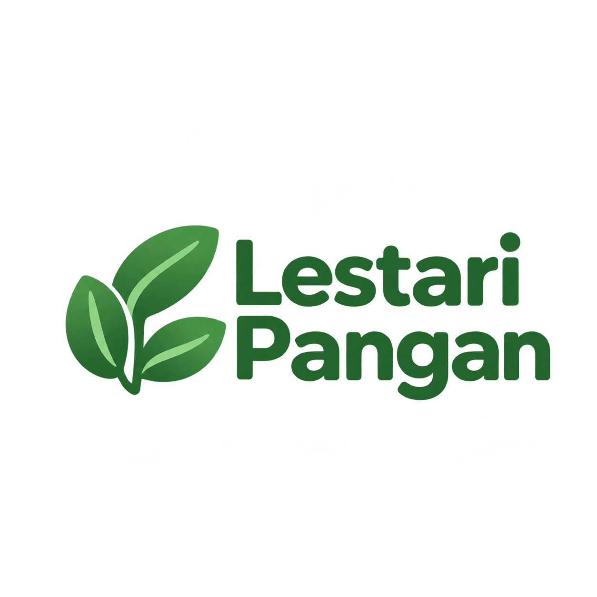
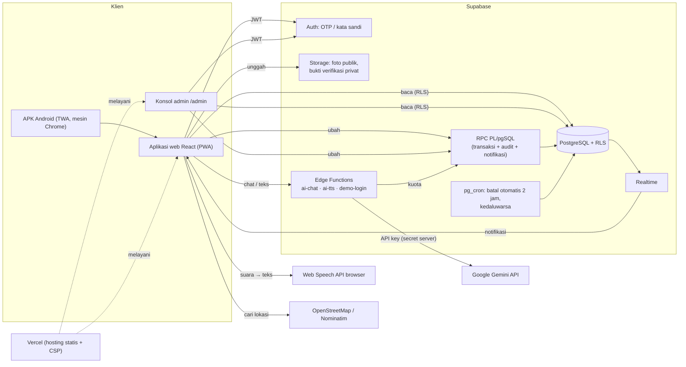
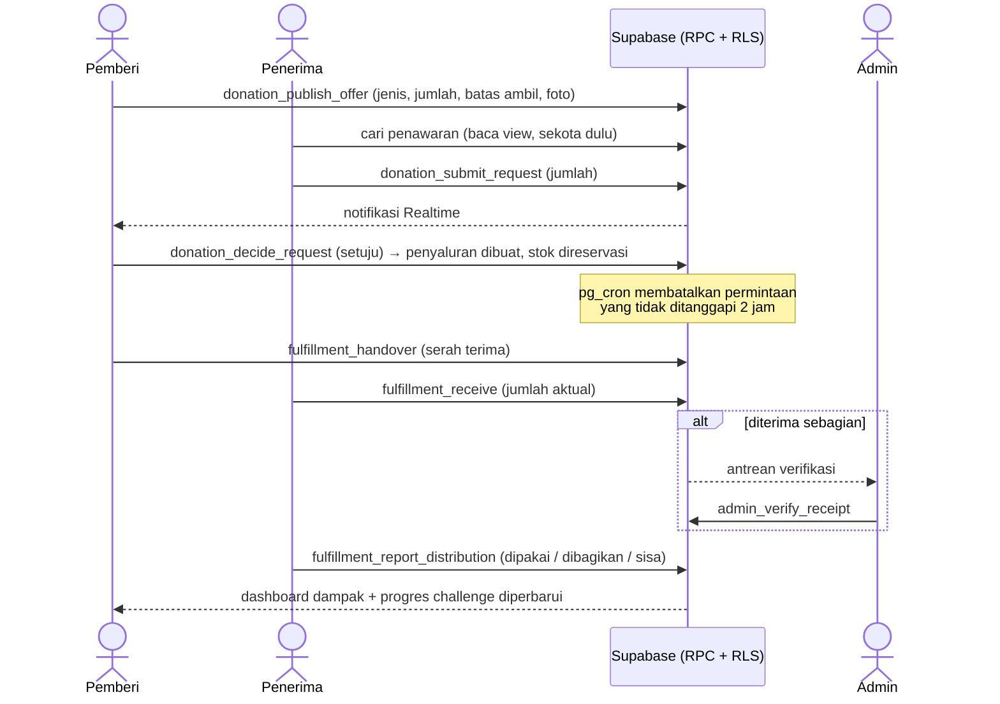

# Lestari Pangan

<p align="center">
  
</p>

<p align="center"><b>Bijak Konsumsi, Kurangi Sisa, Jaga Bumi.</b></p>

<p align="center">
  <a href="https://github.com/bannerevander/lestari-pangan/releases/latest/download/lestari-pangan.apk"><b>⬇ Unduh APK Android</b></a> ·
  <a href="https://lestari-pangan.vercel.app"><b>Buka aplikasi web</b></a> ·
  <a href="#akun-demo-untuk-juri"><b>Akun demo</b></a> ·
  <a href="#video-demo"><b>Video demo</b></a>
</p>

Aplikasi mobile yang mempertemukan restoran, UMKM, dan rumah tangga yang punya **surplus pangan layak konsumsi** dengan panti dan komunitas yang membutuhkan, lengkap dari penawaran, permintaan, pengantaran, konfirmasi penerimaan, sampai laporan distribusi. Dilengkapi **Asisten Dapur AI** yang bisa diajak ngobrol pakai suara untuk mengolah sisa bahan.

## Daftar isi

1. [Tim](#tim)
2. [Ringkasan solusi](#ringkasan-solusi)
3. [Fitur yang sudah berjalan](#fitur-yang-sudah-berjalan)
4. [Unduh dan coba](#unduh-dan-coba)
5. [Teknologi](#teknologi)
6. [Arsitektur dan alur data](#arsitektur-dan-alur-data)
7. [Instalasi dan menjalankan di localhost](#instalasi-dan-menjalankan-di-localhost)
8. [Penggunaan AI](#penggunaan-ai)
9. [Keamanan, privasi, dan etika](#keamanan-privasi-dan-etika)
10. [Atribusi](#atribusi)
11. [Struktur repo dan dokumentasi](#struktur-repo-dan-dokumentasi)

## Tim

**Nama tim: NightOwl**

| Peran | Nama |
| --- | --- |
| Ketua tim | Banner Evander Salim |
| Anggota 1 | Joshua |
| Anggota 2 | Nicholas Zender Wang |

## Ringkasan solusi

| | |
| --- | --- |
| **Kompetisi** | LOGICODIX Hackathon 2026 |
| **Kategori** | Mobile Apps |
| **Subtema** | Green Environment & Sustainability (SDG 12: konsumsi dan produksi yang bertanggung jawab, target 12.3) |
| **Nama aplikasi** | Lestari Pangan |
| **Bentuk** | Progressive Web App mobile-first, dikemas sebagai **APK Android** (Trusted Web Activity) |

### Masalah

- Indonesia kehilangan dan membuang **23–48 juta ton pangan per tahun** (115–184 kg per orang per tahun, periode 2000–2019) menurut kajian *Food Loss and Waste di Indonesia* (Bappenas, 2021). [UNEP Food Waste Index Report 2024](https://www.unep.org/resources/publication/food-waste-index-report-2024) juga menempatkan sampah makanan rumah tangga Indonesia di antara yang terbesar di Asia Tenggara.
- Di sisi lain, panti asuhan, panti jompo, dan dapur komunitas masih kekurangan pasokan pangan.
- Restoran, UMKM, dan rumah tangga yang punya kelebihan makanan tidak tahu harus menghubungi siapa, dan penyaluran lewat grup chat tidak tercatat: tidak jelas berapa yang benar-benar diterima, dipakai, atau akhirnya terbuang.

### Solusi

Lestari Pangan menjadi tempat **menawarkan, meminta, dan menelusuri** surplus pangan:

1. Pemberi mencatat atau langsung menawarkan surplus (jenis, jumlah, waktu dimasak, alergen, batas ambil, foto).
2. Penerima mencari penawaran terdekat sesuai kebutuhan dan kapasitas, lalu mengajukan jumlah.
3. Pemberi menyetujui; kedua pihak menyepakati jadwal dan cara penyaluran (ambil sendiri atau ojek online GoSend/GrabExpress, aplikasi menyiapkan alamat dan catatan driver untuk disalin).
4. Serah terima dicatat, penerima mengonfirmasi **jumlah aktual** yang diterima, lalu melaporkan penggunaan/distribusi dan sisa.
5. Dashboard dampak, Eco Challenge, dan reward diperbarui dari kegiatan yang benar-benar selesai, bukan dari penawaran saja.

Asisten Dapur AI membantu mencegah sisa sejak dari dapur: pengguna menyebut bahan yang ada, AI menyarankan resep dan cara menyimpan, lalu membacakan jawabannya.

### Target pengguna

| Peran | Siapa | Manfaat |
| --- | --- | --- |
| **Pemberi donasi** | Restoran, UMKM kuliner, rumah tangga | Menemukan penerima yang cocok, koordinasi lebih mudah, riwayat penyaluran dan pola surplus tercatat |
| **Penerima donasi** | Panti asuhan, panti jompo, dapur/komunitas makanan gratis | Menemukan pangan sesuai kebutuhan dan kapasitas, mengatur penerimaan, mencatat distribusi |
| **Admin (staf operasional)** | Pengelola platform | Verifikasi akun, tangani kendala, kelola konten/challenge/reward/promosi, buku kas dan laporan pendanaan |

Memberi dan menerima donasi **gratis**. Pembayaran, poin, dan reward tidak memberi prioritas mendapatkan pangan.

## Fitur yang sudah berjalan

Semua fitur di bawah tersambung ke backend Supabase produksi dan bisa dicoba dengan [akun demo](#akun-demo-untuk-juri).

| Fitur | Yang bisa dilakukan |
| --- | --- |
| **Akun dan verifikasi** | Daftar/masuk dengan kode OTP email atau kata sandi, pilih peran, profil organisasi, kebutuhan dan kapasitas penerima, lokasi (514 kab/kota + peta), unggah bukti verifikasi (privat) |
| **Donasi Makanan** | Pemberi menerbitkan, mengubah, dan menutup penawaran (data wajib per kategori, batas per penerima, foto diperkecil dan EXIF dibuang). Penerima mencari dan memfilter penawaran (sekota tampil lebih dulu), mengajukan permintaan; pemberi menyetujui/menolak/mengusulkan penyesuaian; permintaan batal otomatis bila tidak ditanggapi 2 jam |
| **Penyaluran** | Jadwal, cara penyaluran, kartu **Pesan pengiriman** ojek online, koordinasi Telepon/WhatsApp, catat penyerahan, konfirmasi penerimaan penuh/sebagian/tolak (sebagian diverifikasi admin), ajukan ongkir ditanggung pemberi, laporan distribusi, lapor kendala dengan foto |
| **Catat Pangan** | Catat stok dan pangan terbuang beserta alasannya, ubah catatan menjadi penawaran tanpa mengetik ulang, penerimaan otomatis jadi catatan |
| **Dashboard dampak** | Pangan diserahkan, diterima, didistribusikan, dan terbuang per peran dan periode, dihitung dari penyaluran nyata per satuan |
| **Asisten Dapur AI (chat + suara)** | Tombol "Tanya AI" di semua tab; ketik atau ngobrol pakai suara (dengar → AI menjawab mengalir → dibacakan → dengar lagi), memakai bahan di Catat Pangan dan katalog resep terkurasi; menolak pertanyaan di luar topik makanan |
| **Resep dari Sisa dan Tips** | Katalog resep dan artikel tips dari database, simpan favorit, catat bahan terpakai |
| **Eco Challenge dan reward** | Ikut challenge, progres dari server, ajukan pemeriksaan, poin, tukar poin dengan Paket Dukungan Penyaluran atau Paket Apresiasi Mitra (persetujuan materi publikasi) |
| **Dukungan pendanaan** | Donasi operasional/sponsor pengiriman lewat transfer manual + kode referensi, divalidasi admin; halaman transparansi dana |
| **Notifikasi** | Notifikasi in-app real-time (Supabase Realtime) untuk permintaan, persetujuan, penyaluran, dan balasan tiket |
| **Pusat bantuan** | Tiket bantuan dan permintaan hapus data; admin membalas |
| **Konsol admin** (`/admin`) | Verifikasi, kendala, verifikasi penerimaan sebagian, konten + sampul, challenge, reward, klaim, apresiasi, promosi banner per wilayah, tiket, buku kas, program, laporan, jejak audit. Responsif: tabel di laptop, kartu di HP |

Rincian status per layar: [docs/PROGRESS.md](docs/PROGRESS.md).

## Unduh dan coba

### Aplikasi Android (APK)

**[⬇ Unduh lestari-pangan.apk](https://github.com/bannerevander/lestari-pangan/releases/latest/download/lestari-pangan.apk)** (±1,6 MB, Android 7.0+), atau lihat halaman [Releases](https://github.com/bannerevander/lestari-pangan/releases).

1. Buka tautan di atas **dari browser HP Android**; berkas langsung terunduh.
2. Ketuk berkas yang terunduh. Bila diminta, izinkan **Instal aplikasi tidak dikenal** untuk browser/pengelola berkas (APK tidak berasal dari Play Store).
3. Buka **Lestari Pangan** dari laci aplikasi. Google Chrome harus terpasang.

APK adalah Trusted Web Activity: membuka aplikasi yang sama dengan versi web dalam mesin Chrome, layar penuh tanpa bilah alamat, termasuk mikrofon untuk Asisten Dapur. WebView biasa (Capacitor/Cordova) tidak dipakai karena tidak mendukung pengenalan suara. Data paket dan sidik jari kunci: [docs/ANDROID.md](docs/ANDROID.md).

### Versi web

| Bagian | Alamat |
| --- | --- |
| Aplikasi pengguna (pemberi, penerima) | https://lestari-pangan.vercel.app (di laptop tampil sebagai kolom HP di tengah layar) |
| Konsol admin | https://lestari-pangan.vercel.app/admin/masuk |

Di iPhone, buka versi web di Safari lalu **Bagikan → Tambahkan ke Layar Utama**.

### Akun demo untuk juri

Kata sandi semua akun: `test123`

| Peran | Email | Tempat masuk |
| --- | --- | --- |
| Pemberi (Warung Makan Bu Sari, Kota Bandung) | `pemberi@example.com` | Aplikasi / APK |
| Penerima (Dapur Komunitas Harapan, Kota Bandung) | `penerima@example.com` | Aplikasi / APK |
| Admin (semua lingkup) | `admin@example.com` | `/admin/masuk`, atau tautan **Masuk sebagai staf operasional** di bawah halaman masuk |

Cara masuk: pilih tab **Kata sandi** lalu isi email dan kata sandi, **atau** pilih **Kode verifikasi**, isi email akun demo, ketuk **Kirim kode** (akun demo langsung masuk tanpa email). Juri tidak perlu membayar apa pun. Skenario uji langkah demi langkah: [docs/AKUN-UJI.md](docs/AKUN-UJI.md).

### Video demo

Video demo YouTube (3–5 menit): **https://youtu.be/ISI-TAUTAN-VIDEO**

## Teknologi

| Lapisan | Teknologi |
| --- | --- |
| Front end | React 18, TypeScript 5, Vite 5, Tailwind CSS 3, React Router 6, Phosphor Icons, font Inter (dibundel lokal), Leaflet + OpenStreetMap |
| Aplikasi mobile | PWA (manifest + ikon) dikemas Trusted Web Activity lewat PWABuilder → APK Android |
| Backend | Supabase (free tier): PostgreSQL 17, Row Level Security, RPC PL/pgSQL, Auth (OTP email + kata sandi), Storage, Realtime, pg_cron |
| Serverless | Supabase Edge Functions (Deno/TypeScript): `ai-chat`, `ai-tts`, `demo-login` |
| AI | Google Gemini API (chat + text-to-speech), Web Speech API browser (speech-to-text) |
| Hosting | Vercel (deploy otomatis dari branch `main`), header keamanan CSP/HSTS |
| Pengujian | pgTAP (95 asersi untuk RLS, RPC, kuota), `node --test` untuk pengaman env, ESLint, `tsc` |

## Arsitektur dan alur data

Modular monolith tanpa server sendiri: semua logika bisnis ada di Supabase. Klien **membaca** tabel/view yang dibatasi RLS dan **mengubah data hanya lewat RPC** (satu fungsi = satu transaksi + jejak audit + notifikasi). Kunci rahasia hanya ada di Edge Functions. Rincian keputusan: [docs/architecture.md](docs/architecture.md).



Alur data utama (donasi sampai distribusi):



Alur Asisten Dapur AI: ucapan → teks oleh Web Speech API (`id-ID`) → Edge Function `ai-chat` memeriksa sesi dan kuota (40 pesan/jam), menambahkan daftar bahan Catat Pangan + judul resep terkurasi, memanggil Gemini, dan mengalirkan jawaban (SSE) → kalimat jawaban dikirim ke `ai-tts` (Gemini TTS) → audio diputar → aplikasi mendengarkan lagi.

## Instalasi dan menjalankan di localhost

Kebutuhan: **Node.js 18+** (disarankan 20 LTS), npm, dan proyek Supabase (gratis).

### 1. Front end

```bash
git clone https://github.com/bannerevander/lestari-pangan.git
cd lestari-pangan/lestari-pangan-frontend
npm install
cp .env.example .env.local
```

Isi `.env.local` (lihat [`.env.example`](lestari-pangan-frontend/.env.example)):

| Variabel | Isi |
| --- | --- |
| `VITE_SUPABASE_URL` | URL proyek Supabase (Dashboard → Project Settings → API) |
| `VITE_SUPABASE_PUBLISHABLE_KEY` | Publishable key (`sb_publishable_...`). **Jangan** isi service role/secret key: build sengaja gagal bila ada |

```bash
npm run dev       # http://localhost:5173 (konsol admin: http://localhost:5173/admin/masuk)
npm run build     # type-check + build produksi
npm run preview   # melayani hasil build dengan header keamanan yang sama seperti Vercel
```

Untuk mencoba cepat memakai backend produksi, isi kedua variabel dengan URL dan publishable key proyek Lestari Pangan (keduanya memang publik dan sudah tertanam di bundle web); akun demo di atas langsung bisa dipakai di localhost.

### 2. Backend Supabase (bila memakai proyek sendiri)

1. Buat proyek di [supabase.com](https://supabase.com), lalu jalankan berkas di [`supabase/migrations/`](supabase/migrations) **berurutan menurut nama** lewat SQL Editor (atau `supabase db push` dengan Supabase CLI).
2. Deploy Edge Functions:

   ```bash
   supabase functions deploy ai-chat --no-verify-jwt
   supabase functions deploy ai-tts --no-verify-jwt
   supabase functions deploy demo-login --no-verify-jwt
   ```

3. Isi secret Edge Functions (Dashboard → Edge Functions → Secrets), contoh di [`supabase/functions/.env.example`](supabase/functions/.env.example). Wajib: `GEMINI_API_KEY` dari [Google AI Studio](https://aistudio.google.com/apikey) (tier gratis).
4. (Opsional) Jalankan tes pgTAP di [`supabase/tests/`](supabase/tests) lewat SQL Editor; semua baris harus `ok`.

Panduan lengkap backend, akun admin, dan langkah manual dashboard: [supabase/README.md](supabase/README.md), [docs/SECURITY.md](docs/SECURITY.md).

## Penggunaan AI

| Layanan / model | Dipakai untuk fitur | Data yang dikirim |
| --- | --- | --- |
| Google Gemini API tier gratis: `gemini-3.5-flash-lite`, cadangan `gemini-3.1-flash-lite` dan `gemini-3.8-flash` | **Asisten Dapur AI**: ide resep dari bahan, cara menyimpan, mengolah sisa makanan; menolak topik di luar makanan (jawaban terstruktur `on_topic`) | 12 pesan terakhir, daftar bahan Catat Pangan pengguna, judul resep terkurasi. Lewat Edge Function `ai-chat`; kunci API hanya di secret server. Data tier gratis dapat dipakai Google untuk pengembangan produk, dan ini disampaikan di layar |
| Google Gemini TTS: `gemini-3.8-flash-lite-tts` (kalimat pertama), `gemini-3.8-flash-tts` (sisanya), suara Sulafat | **Suara Asisten Dapur**: membacakan jawaban dalam Bahasa Indonesia | Teks jawaban per potongan ±280 huruf lewat Edge Function `ai-tts` (kuota 120 potongan/jam/akun). Bila gagal, aplikasi memakai suara browser |
| Web Speech API bawaan browser | **Mode suara**: ucapan → teks (`id-ID`); cadangan pembaca jawaban | Audio diproses layanan suara browser (Google pada Chrome), tidak dikirim ke server Lestari Pangan |
| ChatGPT (OpenAI), pembuatan gambar | Foto penawaran contoh, sampul resep/tips, banner promosi awal ([`assets/`](assets)) | Hanya prompt deskripsi gambar, tanpa data pengguna. Gambar ini ilustrasi, bukan foto makanan nyata pengguna |
| Claude Code (Anthropic) | Asisten pemrograman selama pengembangan (penulisan kode, dokumentasi, pengujian) | Kode sumber repo ini; tidak ada data pengguna |

Batasan yang dijaga: riwayat obrolan hanya disimpan di perangkat pengguna; server hanya mencatat waktu permintaan untuk kuota. Asisten **tidak menyatakan makanan aman** hanya dari deskripsi, tanggal, atau foto, dan layar chat menjelaskan bahwa jawaban dibuat AI.

## Keamanan, privasi, dan etika

- **Tanpa rahasia di kode atau front end.** Hanya URL Supabase dan publishable key di env browser; build gagal bila ada secret key ([`config/publicEnvGuard.ts`](lestari-pangan-frontend/config/publicEnvGuard.ts)). Kunci Gemini hanya di secret Edge Function. `.env` diabaikan git; contoh ada di `.env.example`.
- **Row Level Security di semua tabel**, klien tidak punya hak `INSERT/UPDATE/DELETE` langsung; perubahan lewat RPC yang memeriksa peran, status, dan stok. Kolom privat profil, alamat rinci, dan kontak hanya terbuka untuk pihak yang sedang berkegiatan.
- **Berkas privat**: bukti verifikasi dan foto kendala di bucket privat; foto penawaran diperkecil di perangkat dan metadata EXIF (termasuk lokasi GPS) dibuang sebelum diunggah.
- **Header keamanan** CSP, HSTS, X-Frame-Options, Referrer-Policy di Vercel.
- **Kuota AI per akun** mencegah penyalahgunaan dan menjaga kuota tetap hidup selama penjurian.
- **Hak pengguna**: permintaan hapus data lewat Pusat bantuan; persetujuan mitra sebelum nama/logo dipublikasikan di Paket Apresiasi.
- **Jujur soal data**: penawaran tidak dihitung sebagai donasi berhasil; laporan sisa, penolakan, dan kendala tetap bisa dicatat.

Rincian pemeriksaan: [docs/SECURITY.md](docs/SECURITY.md).

## Atribusi

| Sumber | Dipakai untuk | Lisensi / keterangan |
| --- | --- | --- |
| [React](https://react.dev), [Vite](https://vitejs.dev), [React Router](https://reactrouter.com), [Tailwind CSS](https://tailwindcss.com), [TypeScript](https://www.typescriptlang.org) | Kerangka front end | MIT / Apache-2.0 |
| [supabase-js](https://github.com/supabase/supabase-js) | Klien backend | MIT |
| [Phosphor Icons](https://phosphoricons.com) | Ikon antarmuka | MIT |
| [Inter](https://rsms.me/inter/) via `@fontsource/inter` | Huruf | SIL Open Font License 1.1 |
| [Leaflet](https://leafletjs.com) | Peta pilih lokasi | BSD-2-Clause |
| [OpenStreetMap](https://www.openstreetmap.org/copyright) + Nominatim | Ubin peta dan pencarian alamat | Data © kontributor OpenStreetMap, ODbL |
| Kepmendagri No. 300.2.2-2138 Tahun 2025 (kode dan data wilayah) | Daftar 514 kab/kota dan 38 provinsi ([`data/kota.json`](lestari-pangan-frontend/src/data)) | Data pemerintah, publik |
| [PWABuilder](https://www.pwabuilder.com) | Membuat paket APK Trusted Web Activity | Layanan gratis Microsoft, kode MIT |
| Google Stitch | Eksplorasi desain layar awal (wireframe), lalu diimplementasikan ulang sebagai kode React | Ilustrasi SVG dan beberapa foto contoh dari ekspor Stitch ada di `public/illustrations` dan `public/img` |
| ChatGPT (OpenAI) | Gambar contoh di [`assets/`](assets) dan konten awal | Gambar buatan AI, lihat [Penggunaan AI](#penggunaan-ai) |
| Bappenas (2021), UNEP Food Waste Index Report 2024, [SDG 12](https://sdgs.un.org/goals/goal12) | Data latar masalah | Dikutip sebagai rujukan |

Daftar lengkap dependensi: [`lestari-pangan-frontend/package.json`](lestari-pangan-frontend/package.json).

## Struktur repo dan dokumentasi

| Folder | Isi |
| --- | --- |
| [`lestari-pangan-frontend/`](lestari-pangan-frontend) | Kode aplikasi (React + Vite), di-hosting di Vercel; [README](lestari-pangan-frontend/README.md) |
| [`supabase/`](supabase) | Backend: migrasi (skema, RLS, RPC, job), Edge Functions, tes pgTAP; [README](supabase/README.md) |
| [`docs/`](docs) | Requirement, arsitektur, desain, keamanan, progres, akun uji, Android |
| [`assets/`](assets) | Logo, foto contoh, sampul konten |
| [`prototype/`](prototype) | Prototipe klik (data lokal, tanpa backend) untuk uji alur desain |

| Dokumen | Isi |
| --- | --- |
| [docs/PROGRESS.md](docs/PROGRESS.md) | Status per area dan per layar, utang teknis, log pekerjaan |
| [docs/architecture.md](docs/architecture.md) | Keputusan arsitektur, skema database, daftar RPC |
| [docs/REQUIREMENTS.md](docs/REQUIREMENTS.md) | Requirement fungsional/nonfungsional dan kriteria penerimaan |
| [docs/design.md](docs/design.md) | Panduan UI: navigasi, komponen, warna, aksesibilitas, motion |
| [docs/SECURITY.md](docs/SECURITY.md) | Lapisan keamanan dan hasil pemeriksaan |
| [docs/CONVENTIONS.md](docs/CONVENTIONS.md) | Aturan pembagian berkas kode, service, migrasi |
| [docs/AKUN-UJI.md](docs/AKUN-UJI.md) | Akun demo dan skenario uji |
| [docs/ANDROID.md](docs/ANDROID.md) | APK Android (TWA): data paket, cara memasang, membuat versi baru |

Terakhir diperbarui: **14 November 2026**.
