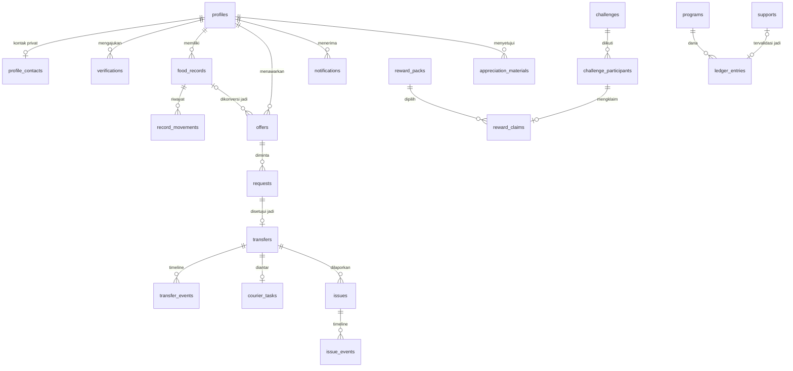

# Arsitektur Lestari Pangan

Versi 0.3 | 12 Oktober 2026

Dokumen ini mencatat keputusan arsitektur backend dan database yang **sudah disetujui**. Hal yang masih dibahas ada di bagian 11 dan belum menjadi kontrak implementasi. Kebutuhan produk tetap mengacu pada [REQUIREMENTS.md](REQUIREMENTS.md); desain UI pada [design.md](design.md). Keamanan: [SECURITY.md](SECURITY.md). Aturan kode: [CONVENTIONS.md](CONVENTIONS.md). Status kerja: [PROGRESS.md](PROGRESS.md).

## 1 Konteks dan batasan

| Batasan | Dampak pada arsitektur |
| --- | --- |
| Proyek sekolah dan persiapan lomba hackathon; dikembangkan satu orang dengan bantuan AI. | Sesedikit mungkin layanan yang harus dirawat. |
| Semua layanan wajib free tier pada tahap ini. | Tidak ada server terpisah yang harus selalu menyala. |
| Skala pilot komunitas (ratusan sampai beberapa ribu pengguna). | Kebenaran data lebih penting daripada skala. |
| Front end sudah ada: React + Vite + TypeScript, aplikasi mobile dan konsol admin (`/admin`, chunk terpisah). | Backend melayani dua klien dari satu database. |
| Data sangat relasional, ada reservasi bersamaan (AT-01), dana (AT-09), dan audit. | Transaksi ACID di database menjadi syarat. |

## 2 Keputusan yang disetujui

| ID | Keputusan | Alasan |
| --- | --- | --- |
| AR-01 | Gaya **modular monolith**: satu backend, dibagi per modul domain. | Transaksi lintas entitas (permintaan → stok → penyaluran) tetap utuh dalam satu transaksi; microservices berlebihan untuk skala ini. |
| AR-02 | Bahasa **TypeScript** (front end, Edge Functions) dan **SQL/PL-pgSQL** (inti transaksi). | Satu bahasa aplikasi; tipe tabel dibuat otomatis (`supabase gen types`); keduanya dikuasai baik oleh AI. |
| AR-03 | Platform backend **Supabase free tier**: PostgreSQL, Auth, Storage, Realtime, Edge Functions, pg_cron. **Tanpa server terpisah.** | Rp0, tanpa cold start pada RPC, transaksi atomik langsung di database, satu layanan untuk dirawat. Server gratis yang tidur (mis. Render, bangun ±1 menit) berisiko saat demo. |
| AR-04 | Distribusi aplikasi sebagai **PWA** terlebih dulu. Capacitor (APK) hanya ditambahkan bila lomba mewajibkan. | Juri cukup membuka satu URL; front end sudah web; kode yang sama dapat dibungkus Capacitor kemudian. |
| AR-05 | Login **email + OTP** melalui Supabase Auth dengan **SMTP sendiri**. Sejak 13 Nov 2026 ada metode kedua: **kata sandi** (opsional, dibuat di Pengaturan → Keamanan akses). Akun uji `@example.com` yang memilih kode langsung masuk lewat Edge Function `demo-login` (daftar 4 alamat tetap; dihapus setelah penjurian). | SMTP bawaan Supabase hanya mengirim ke anggota tim proyek, sehingga OTP gagal untuk pengguna lain. |
| AR-06 | SMTP memakai **akun Gmail khusus proyek + App Password** (±500 email/hari). Pindah ke Resend bila proyek memiliki domain sendiri. | Rp0 tanpa domain; volume OTP jauh di bawah batas. Risiko masuk spam diuji sebelum demo. |
| AR-07 | **Satu akun satu peran** (pemberi, penerima, kurir, atau admin); peran ditetapkan saat onboarding. Tombol ganti peran di prototipe hanya untuk demo. | Hak akses dan RLS sederhana; menjawab sebagian OD-02. |
| AR-08 | Permintaan **disetujui oleh pemberi** (bukan klaim langsung); stok baru dikunci saat disetujui. | Sesuai alur prototipe; menjawab sebagian OD-01. |
| AR-09 | Penyaluran `Terjadwal` yang melewati jadwal **tidak diubah otomatis**; sistem hanya memberi notifikasi ke pihak terkait dan admin. | Tidak menyimpulkan hasil yang belum terjadi (AT-03). |
| AR-10 | Skema database, RLS, view, dan RPC mengikuti bagian 9. | Disetujui setelah tinjauan draf. |
| AR-11 | Front end di-hosting di **Vercel** (paket Hobby, non-komersial) dengan header keamanan di `vercel.json`; produksi di https://lestari-pangan.vercel.app. Front end memanggil Supabase langsung memakai publishable key. | Gratis, preview otomatis per push; keamanan data tetap di database (RLS + RPC). |
| AR-12 | **Kode dibagi per tanggung jawab**: satu layar per berkas di `pages/<fitur>/`, akses Supabase hanya di `services/<modul>.ts`, aturan lengkap di CONVENTIONS.md. | Mudah dilacak dan diuji oleh pengembang tunggal. |
| AR-13 | Akun **boleh menawarkan dan meminta sebelum diverifikasi admin** (menjawab AO-09). Galat `BELUM_TERVERIFIKASI` tidak dipakai di alur donasi. | Hambatan awal rendah untuk pilot; verifikasi tetap tampil sebagai status akun. |
| AR-14 | Pembayaran dukungan **cukup transfer manual** yang divalidasi admin keuangan (menjawab AO-05). QRIS/penyedia otomatis tidak dikerjakan untuk lomba. | Rp0, tanpa integrasi pihak ketiga sebelum code freeze. |
| AR-15 | Push notification web **boleh, tetapi ditunda** (menjawab AO-06); fokus pada fitur di dalam aplikasi. Notifikasi in-app lewat Realtime tetap jalur utama. | Waktu pengembang tunggal dipakai untuk alur inti. |
| AR-16 | OD-01: permintaan yang **tidak ditanggapi lebih dari 2 jam batal otomatis** (`job_expire_requests`, tiap 5 menit; usulan penyesuaian dihitung dari `proposal_at`). Pemberi boleh **membatasi jumlah per penerima** (opsional, `offers.max_per_recipient`). Pembagian sebagian, satu permintaan aktif per penawaran, dan pembatalan hanya sebelum disetujui tetap. | Stok tidak tertahan lama; lebih banyak penerima kebagian. |
| AR-17 | OD-02: **cukup email + OTP**; langkah unggah bukti verifikasi dilewati saat daftar dan menu verifikasi disembunyikan. Tabel dan konsol verifikasi tetap ada untuk nanti. | Hambatan daftar rendah selama lomba. |
| AR-18 | OD-03: kategori tetap 3. **Data wajib per kategori**: semua wajib penyimpanan; Makanan matang wajib waktu dimasak; Produk kemasan wajib tanggal label yang belum lewat (`private.check_offer_fields`). Penerimaan **sebagian/penolakan wajib alasan (≥10 karakter) dan diverifikasi staf ops** (status `Menunggu verifikasi`, `admin_verify_receipt`) sebelum dampak dan catatan pangan tercatat. | Mencegah penolakan sepihak tanpa alasan dan data dampak yang keliru. |
| AR-19 | OD-04: ongkir hanya untuk **Mitra pengiriman**, bawaan **ditanggung penerima**; penerima bisa mengajukan ke pemberi (`fulfillment_request_fee` / `fulfillment_respond_fee`). Ongkir dibayar langsung ke mitra, tidak lewat aplikasi; aplikasi mencatat siapa pembayarnya. Ambil sendiri dan Antar pemberi tanpa ongkir untuk penerima. Kegagalan pengiriman dan tanpa refund tetap. | Tanpa aliran uang baru sebelum code freeze. |
| AR-20 | OD-05: challenge yang **lolos memberi poin** (`challenges.points`), poin **ditukar paket reward** (`reward_packs.cost`, saldo dihitung server `private.points_balance`); klaim ditolak mengembalikan poin. Challenge bisa diikuti lagi **di periode berikutnya** (periode disalin ke `challenge_participants`; admin menggeser periode setelah periode lama selesai). Sponsor memakai nama fiksi. | Sesuai keputusan pemilik produk 10 Nov 2026. |
| AR-24 | **Suara asisten dari Gemini TTS** (13 Nov 2026). Edge Function `ai-tts` (kunci Gemini yang sama, kuota `ai_take_tts_quota` 120 potongan/jam/akun terpisah dari chat, migrasi `ai_tts_quota`). Kalimat pertama memakai `gemini-3.8-flash-lite-tts` agar cepat mulai, sisanya `gemini-3.8-flash-tts` per ±280 huruf yang disiapkan selagi potongan sebelumnya diputar; model/kunci diselang-seling saat batas per menit. Arahan gaya ditulis sebagai profil suara + catatan sutradara + TRANSCRIPT karena model 3.x menolak systemInstruction dan ikut membacakan awalan biasa. Mode suara: ai-chat menerima `voice: true` (aturan obrolan singkat di akhir prompt dan di pesan terakhir) dan aplikasi hanya membacakan pembuka sebelum daftar (`forSpeech`). Bila suara Gemini gagal, sisa jawaban memakai suara browser. | Model suara lokal 30–100 MB, lambat di HP menengah, dan pilihan suara Indonesianya lemah; Gemini TTS memakai kunci yang sudah ada tanpa biaya. Batas: kuota gratis per menit (terukur ±7 permintaan/menit/kunci untuk 3.8 Flash), jeda suara pertama ±3–6 dtk. |
| AR-23 | **Lokasi dari peta, gratis** (13 Nov 2026). Pemilih titik (Leaflet + tile OpenStreetMap, dimuat terpisah) di onboarding dan Pengaturan → Lokasi: GPS, cari tempat (Nominatim, hanya saat tombol Cari), atau geser peta; alamat dan kab/kota/kecamatan terisi otomatis dari titik. Titik disimpan di `profile_contacts.lat/lng` (migrasi `profile_location`, lewat `identity_save_profile`) dan dipakai untuk tautan "Buka di Google Maps" di detail penyaluran, Koordinasi, dan teks salinan driver ojek online. | Google Places resmi butuh akun penagihan dan API key milik pengguna; OSM gratis tanpa kunci. shortcut: Nominatim publik tanpa SLA (≤ 1 permintaan/detik), ganti ke penyedia berbayar bila pengguna bertambah. |
| AR-22 | **Peran kurir dihentikan** (13 Nov 2026). Cara penyaluran: Ambil sendiri, Diantar pemberi, atau Ojek online (GoSend/GrabExpress) yang dipesan sendiri oleh pihak yang menanggung ongkir; nilai database `Mitra pengiriman` dipertahankan dan ditampilkan sebagai "Ojek online" (`methodLabel`). Detail penyaluran menyiapkan alamat jemput, tujuan, kontak, dan catatan driver untuk disalin. Halaman kurir, menu Pengiriman admin, dan penugasan kurir dihapus dari front end; tabel `courier_tasks` dan RPC `fulfillment_task_*`/`admin_assign_courier` dibiarkan tidak terpakai agar tidak ada migrasi berisiko sebelum code freeze. Akun berperan kurir ditolak saat masuk. | Jaringan kurir relawan butuh rekrutmen, jadwal, dan admin yang menugaskan setiap kiriman, terlalu berat untuk pilot; ojek online tersedia luas, terlacak, dan cepat untuk makanan matang. Rencana lanjutan: bantuan ongkir dari dana dukungan yang disetujui admin keuangan. |
| AR-21 | AO-04: **Asisten Dapur AI** = chat teks + mode suara. Teks: Edge Function `ai-chat` → Google Gemini tier gratis, urutan `gemini-3.5-flash-lite` → `gemini-3.1-flash-lite` → `gemini-3.8-flash` (bisa diganti lewat secret `GEMINI_MODEL`); kunci di secret berawalan `GEMINI_API_KEY`. Jawaban dialirkan (SSE, `streamGenerateContent`) sepotong demi sepotong; batas waktu hanya untuk diam: 15 detik menunggu kata pertama per model, 20 detik jeda antarpotongan, 40 detik batas memulai percobaan baru. Bila model belum menulis dalam 5 detik, model/kunci berikutnya dijalankan bersamaan (maks. 2) dan yang lebih dulu menulis dipakai; klien diberi status `padat` agar layar menampilkan "mencoba jalur cadangan". Saat model padat (503/diam), model dan kunci diselang-seling (diukur 12 Nov 2026: padat terjadi per model, bukan per kunci); bila model putus di tengah jawaban, klien diberi `reset` lalu model berikutnya mulai ulang. Klien lama tanpa `stream: true` tetap menerima satu JSON. Suara: Web Speech API browser (pengenalan `id-ID` + pembacaan dengan suara Indonesia perempuan bila tersedia: Google Bahasa Indonesia / Microsoft Gadis / Damayanti), bukan Whisper dan bukan speech-to-speech server. Hanya topik makanan: AI membalas penanda `[LUAR_TOPIK]` untuk pesan di luar topik, server menahan awal teks sampai jelas bukan penanda lalu mengganti penanda dengan penolakan baku; pasangan tanya-jawab yang ditolak tidak dikirim lagi sebagai konteks. Kuota 40 pesan/jam/akun (`ai_take_quota`, hanya waktu yang disimpan). Riwayat obrolan hanya di perangkat. | Rp0 dan bisa dibangun sebelum code freeze; data tier gratis Gemini dapat dipakai Google untuk pengembangan produk, sehingga pengguna diberi tahu di layar. |

## 3 Gambaran sistem

```
React PWA (mobile)        React (admin, /admin)
            \               /
             supabase-js + JWT
                    |
  ┌─────────────── Supabase ────────────────┐
  │ BACA     tabel / view + RLS             │
  │ UBAH     RPC Postgres (satu fungsi =    │
  │          satu transaksi + audit +       │
  │          antrean notifikasi)            │
  │ RAHASIA  Edge Functions (TypeScript):   │
  │          token suara, webhook bayar,    │
  │          push                           │
  │ LIVE     Realtime: notifikasi in-app,   │
  │          status penyaluran              │
  │ JADWAL   pg_cron: reservasi kedaluwarsa │
  │          (AT-03), pengingat             │
  │ BERKAS   Storage: foto (publik),        │
  │          dokumen verifikasi (privat)    │
  └─────────────────────────────────────────┘
```

## 4 Aturan lapisan

1. **Baca** langsung dari tabel atau view. RLS memastikan pengguna hanya melihat data miliknya atau data publik (NFR-01, AT-10).
2. **Ubah hanya lewat RPC.** Klien tidak punya hak `INSERT`, `UPDATE`, atau `DELETE` langsung pada tabel. Setiap aksi bisnis adalah satu fungsi Postgres yang memeriksa peran, status, dan stok dalam satu transaksi.
3. **Edge Functions** hanya untuk hal yang memerlukan kunci rahasia atau layanan luar. Kunci API tidak pernah ada di klien.
4. **Notifikasi** ditulis ke tabel dalam transaksi yang sama dengan aksi penyebabnya, lalu disalurkan lewat Realtime. Riwayat in-app tetap terbaca walau push tidak tersedia.
5. Semua skema, fungsi, dan kebijakan RLS disimpan sebagai migrasi di `supabase/migrations/` dalam git, beserta tes SQL untuk skenario AT-01 sampai AT-12.

## 5 Modul

Nama fungsi RPC diberi awalan modul (mis. `donation_decide_request`). Aksi asal diambil dari reducer prototipe `src/state/AppState.tsx` dan `src/admin/store.tsx`.

| Modul | Entitas utama | Aksi prototipe yang menjadi RPC |
| --- | --- | --- |
| identity | akun, profil, organisasi, verifikasi, peran | `onboarded`, `setRole`, `saveProfile`, `setPref`; admin `decide` untuk ORG |
| inventory | catatan pangan, pergerakan jumlah | `addRecord`, `moveRecord`, `correctRecord` |
| donation | penawaran, permintaan, reservasi, usulan penyesuaian | `publishOffer`, `updateOffer`, `closeOffer`, `submitRequest`, `decideRequest`, `cancelRequest`, `proposeAdjustment`, `respondAdjustment` |
| fulfillment | penyaluran, kejadian timeline, distribusi, tugas kurir | `handover`, `receive`, `reportDistribution`, `respondSchedule`, `setMethod`, `setPrep`, `taskPickup`, `taskDeliver` |
| issues | laporan masalah, keberatan | `reportIssue`, `objectIssue`; admin `decide` untuk ISS |
| engagement | tips, resep, challenge, reward, klaim, persetujuan publikasi | `toggleTip`, `toggleRecipe`, `joinChallenge`, `claimReward`, `setAppreciation`; admin `decide` untuk CLM |
| funding | dukungan, program, ledger, bantuan barang | `addSupport`, `setRecurring`, `addInKind`; konfirmasi pembayaran lewat webhook |
| notify | notifikasi | `readNotification`, `readAllNotifications` |
| audit | jejak audit lintas modul | ditulis otomatis oleh setiap RPC admin |

`signIn`/`signOut` ditangani Supabase Auth. `setTheme` dan `reset` tetap di klien.

Peran pengguna: `pemberi`, `penerima`, `kurir`, `admin` (dengan sub-peran operasional, keuangan, dan konten).

## 6 Pola integritas data

| Pola | Penerapan | Requirement |
| --- | --- | --- |
| State machine per entitas | Penawaran, permintaan, penyaluran, masalah, dan klaim punya transisi yang sah; transisi lain ditolak. | FR-DN, FR-PN |
| Reservasi atomik | `UPDATE offers SET available = available - q ... WHERE available >= q`, ditambah `CHECK (available >= 0)`. | AT-01, NFR-02 |
| Idempotensi | RPC pengubah menerima kunci idempotensi; webhook pembayaran memakai `UNIQUE(provider_ref)`. | NFR-02, AT-09 |
| Append-only | Timeline penyaluran, pergerakan catatan, audit, dan ledger dana tidak pernah diubah atau dihapus. Saldo dan status ringkas adalah turunan. | NFR-02, FR-FD-05 |
| Dampak dari penerimaan aktual | Statistik memakai jumlah diterima, bukan penawaran; satu penyaluran dihitung sekali. | FR-IM-02, AT-02, AT-11 |
| Satuan tidak dicampur | Agregasi selalu dikelompokkan per satuan. | FR-CP-01 |
| Privasi di server | Alamat rinci terbuka setelah permintaan disetujui; dokumen verifikasi di bucket privat dengan URL bertanda tangan berumur pendek. | NFR-01, AT-10 |

## 7 Batas free tier dan mitigasi

Angka dari dokumentasi Supabase per Oktober 2026.

| Batas Supabase Free | Nilai | Mitigasi |
| --- | --- | --- |
| Ukuran database | 500 MB per proyek | Data teks pilot hanya beberapa MB; foto tidak disimpan di database. |
| Storage berkas | 1 GB | Foto dikompres di klien sebelum diunggah. |
| Egress | 5 GB + 5 GB cached per bulan | Kompres foto, pilih kolom seperlunya saat query. |
| Pengguna aktif bulanan | 50.000 | Cukup. |
| Edge Function | 500.000 pemanggilan per bulan | Hanya dipakai untuk integrasi. |
| Realtime | 2 juta pesan, 200 koneksi puncak | Cukup untuk demo dan pilot. |
| Jeda otomatis | Proyek dijeda bila aktivitas rendah selama 7 hari | Jaga aktivitas rutin, terutama menjelang penjurian. |
| Email Auth bawaan | Hanya ke anggota tim, kuota per jam sangat kecil | SMTP sendiri (AR-05). |

Cadangan: jalankan `supabase db dump` secara rutin dan simpan di luar Supabase.

## 8 Jalur bila nanti berbayar

Bila aplikasi dipakai nyata, cukup naik ke **Supabase Pro** (USD 25/bulan, termasuk kredit komputasi untuk satu instance Micro). Pro menghapus jeda otomatis dan menaikkan kuota (database 8 GB, storage 100 GB, egress 250 GB). Arsitektur dan kode tidak berubah. Karena databasenya PostgreSQL standar, data dapat dipindah dengan `pg_dump` bila suatu saat perlu keluar dari Supabase.

## 9 Skema database dan RPC

Disetujui 12 Oktober 2026. Dasar: tipe di `src/data/types.ts`, reducer `src/state/AppState.tsx` dan `src/admin/store.tsx`, serta skenario AT-01 sampai AT-12.

### 9.1 Konvensi

| Hal | Usulan | Alasan |
| --- | --- | --- |
| Nama tabel dan kolom | Bahasa Inggris, `snake_case` (`offers`, `pickup_start`) | Sama dengan nama tipe di front end. |
| Nilai status | Teks Indonesia persis seperti di front end (`'Diajukan'`, `'Diterima sebagian'`) dengan `CHECK` | UI tidak perlu tabel terjemahan; `CHECK` lebih mudah diubah lewat migrasi daripada tipe `enum`. |
| Kunci utama | `id bigint generated always as identity` + kolom `code` turunan (`'LP-' \|\| id`) | Kode yang tampil di UI (LP-…, PGR-…, REQ-…) tetap ada tanpa generator sendiri. |
| Waktu | `timestamptz`; diformat ke WIB di klien | Satu sumber zona waktu. |
| Uang | `bigint` rupiah utuh | Tidak ada pembulatan desimal. |
| Jumlah pangan | `numeric(10,2)` + kolom `unit` | Kg bisa pecahan; satuan tidak pernah dijumlahkan lintas jenis (FR-CP-01). |
| Idempotensi pembuatan | Kolom `client_id uuid unique` pada baris yang dibuat klien | Kirim ulang dengan `client_id` sama mengembalikan baris yang sudah ada (NFR-02) tanpa tabel tambahan. |
| Idempotensi transisi | Status sudah sama dengan tujuan → kembalikan baris tanpa perubahan; status lain → galat `STATUS_TIDAK_SESUAI` | Coba ulang karena jaringan tidak menggandakan efek. |

### 9.2 Diagram relasi



### 9.3 Tabel per modul

Kolom `id`, `code`, `created_at` ada di semua tabel dan tidak diulang.

#### identity

| Tabel | Kolom utama | Catatan |
| --- | --- | --- |
| `profiles` | `user_id` (→ `auth.users`, unik), `role` (`pemberi`/`penerima`/`kurir`/`admin`), `admin_scope` (`ops`/`keuangan`/`konten`, null bila bukan admin), `org_name`, `org_type`, `area`, `hours`, `capacity`, `storage`, `verification_status`, `prefs jsonb` | Satu akun = satu organisasi/rumah tangga (banyak cabang/staf adalah P2). Data yang aman ditampilkan ke publik. Baris ada = onboarding selesai. |
| `profile_contacts` | `profile_id` (PK), `pic`, `phone`, `address` | Dipisah supaya RLS bisa membatasi: hanya pemilik, admin, dan pihak dalam penyaluran yang sudah disetujui (NFR-01, AT-10). |
| `verifications` | `profile_id`, `doc_path` (bucket privat), `status` (`Menunggu pemeriksaan`/`Terverifikasi`/`Ditolak`), `reason`, `decided_by`, `decided_at` | Riwayat pengajuan; status terkini disalin ke `profiles.verification_status`. |

#### inventory (Catat Pangan)

| Tabel | Kolom utama | Catatan |
| --- | --- | --- |
| `food_records` | `owner_id`, `name`, `category`, `unit`, `estimate`, `storage`, `status` (`Masih tersedia`/`Ditawarkan`/`Digunakan`/`Didistribusikan`/`Terbuang`), `quantity` (`CHECK >= 0`), `source_transfer_id` | `quantity` adalah saldo cache yang diubah hanya oleh RPC dalam transaksi yang sama dengan pergerakannya. |
| `record_movements` | `record_id`, `kind` (`masuk`/`keluar`/`koreksi`), `label`, `delta`, `note`, `actor_id`, `at` | **Append-only.** `sum(delta)` = `quantity`; tes memeriksa kesamaan ini. |

#### donation

| Tabel | Kolom utama | Catatan |
| --- | --- | --- |
| `offers` | `donor_id`, `record_id` (nullable), `name`, `category`, `unit`, `initial`, `available`, `reserved`, `handed_over`, `estimate`, `photo_path`, `storage`, `prepared_at`, `label_date`, `allergens` (null = belum diketahui), `description`, `area`, `pickup_start`, `pickup_end`, `methods text[]`, `status` (`Draf`/`Tersedia`/`Ditutup`), `client_id` | `CHECK (available >= 0 AND reserved >= 0 AND handed_over >= 0)`. Ini jaring pengaman terakhir AT-01. |
| `requests` | `offer_id`, `recipient_id`, `quantity`, `unit`, `method`, `pickup_at`, `note`, `status` (`Diajukan`/`Menunggu penyesuaian`/`Disetujui`/`Ditolak`/`Dibatalkan`), `reason`, `proposal_quantity`, `proposal_reason`, `proposal_at`, `client_id` | Indeks unik parsial: satu permintaan aktif per (penawaran, penerima). |

#### fulfillment

| Tabel | Kolom utama | Catatan |
| --- | --- | --- |
| `transfers` | `request_id` (unik), `offer_id`, `donor_id`, `recipient_id`, `agreed`, `handed_over`, `received`, `rejected`, `unit`, `method`, `pickup_at`, `window_start`, `window_end`, `status` (`Terjadwal`/`Diserahkan`/`Diterima penuh`/`Diterima sebagian`/`Ditolak`), `pending_schedule jsonb`, `prep text[]`, `distributed`, `used`, `wasted`, `distribution_reported_at`, `overdue_notified_at` | Nama dan foto pangan diambil lewat join ke `offers`, tidak disalin. Dampak dihitung dari `received` saja (FR-IM-02). |
| `transfer_events` | `transfer_id`, `label`, `actor_id`, `note`, `at` | **Append-only.** Timeline yang dilihat pemberi, penerima, dan kurir. |
| `courier_tasks` | `transfer_id` (unik), `courier_id`, `cost`, `payer` (`sponsor`/`pemberi`/`penerima`/`relawan`), `program_id`, `status` (`Menunggu kurir`/`Menunggu ambil`/`Dalam perjalanan`/`Selesai`/`Gagal`), `picked`, `delivered` | Kejadian kurir ditulis ke `transfer_events`, jadi tetap satu timeline. |

#### issues

| Tabel | Kolom utama | Catatan |
| --- | --- | --- |
| `issues` | `transfer_id`, `reporter_id`, `category`, `description`, `priority`, `status` (`Dikirim`/`Sedang ditinjau`/`Selesai`/`Keberatan diajukan`), `resolution`, `client_id` | |
| `issue_events` | `issue_id`, `label`, `actor_id`, `note`, `at` | **Append-only.** |

#### engagement

| Tabel | Kolom utama | Catatan |
| --- | --- | --- |
| `contents` | `kind` (`Tips`/`Resep`), `title`, `category`, `summary`, `body jsonb` (paragraf atau langkah resep), `minutes`, `photo_path`, `version`, `status` (`Draf`/`Menunggu review`/`Terbit`), `author`, `reviewed_by`, `reviewed_at` | Hanya `Terbit` yang terbaca pengguna (FR-TP-02). |
| `saved_contents` | `user_id`, `content_id` (PK gabungan) | Menggantikan `savedTips` dan `savedRecipes`. |
| `challenges` | `title`, `period_start`, `period_end`, `roles text[]`, `metric` (mis. `catat_pangan`, `penawaran_alergen`, `laporan_distribusi_24j`), `target_count`, `status` (`Draf`/`Aktif`/`Arsip`) | Aturan disimpan sebagai `metric` + `target_count`, bukan teks bebas, supaya progres bisa dihitung. |
| `challenge_participants` | `challenge_id`, `user_id` (unik gabungan), `joined_at`, `status` (`Berjalan`/`Menunggu verifikasi`/`Lolos`/`Tidak lolos`), `verified_by` | Progres **tidak disimpan**, dihitung oleh view dari data kegiatan (9.5). |
| `reward_packs` | `title`, `detail`, `sponsor`, `quota`, `claimed`, `eligible_roles text[]` | `CHECK (claimed <= quota)`: stok tidak bisa negatif (AT-07). |
| `reward_claims` | `participant_id` (unik), `pack_id`, `status` (`Diajukan`/`Siap disalurkan`/`Diserahkan`/`Ditolak`) | Satu hak klaim per challenge yang lolos (AT-07). |
| `appreciation_materials` | `user_id`, `version`, `caption`, `image_path`, `status` (`Draf`/`Disetujui`/`Revisi diminta`), `approved_at` | Setiap perubahan caption = baris versi baru yang perlu persetujuan lagi (AT-08). |

#### funding

| Tabel | Kolom utama | Catatan |
| --- | --- | --- |
| `programs` | `title`, `sponsor`, `period_start`, `period_end`, `budget`, `status` | |
| `supports` | `user_id`, `amount`, `allocation`, `status` (`Menunggu verifikasi`/`Tervalidasi`/`Dibatalkan`), `provider_ref` (unik, nullable), `client_id` | Janji dukungan dari pengguna. |
| `recurring_supports` | `user_id` (unik), `amount`, `day` | |
| `in_kind_supports` | `user_id`, `kind`, `amount_text`, `status` | Barang tidak dikonversi ke rupiah. |
| `ledger_entries` | `at`, `kind` (`Masuk`/`Keluar`), `fund` (`operasional`/`pengiriman`/`bantuan_langsung`/`program`), `program_id`, `amount`, `source`, `transfer_id`, `support_id` (unik), `provider_ref` (unik), `recorded_by`, `note` | **Append-only.** Koreksi = entri pembalik, bukan UPDATE. Saldo = view. `UNIQUE(provider_ref)` membuat webhook ganda tidak menambah saldo (AT-09). |

#### notify dan audit

| Tabel | Kolom utama | Catatan |
| --- | --- | --- |
| `notifications` | `profile_id`, `kind` (`Kegiatan`/`Reward`/`Sistem`), `title`, `body`, `link`, `cta`, `read_at` | Ditulis RPC dalam transaksi yang sama; dikirim ke klien lewat Realtime. |
| `audit_log` | `at`, `actor_id`, `action`, `target`, `before`, `after`, `reason` | **Append-only**, termasuk untuk admin: tidak ada kebijakan UPDATE/DELETE, ditambah trigger yang menolak keduanya. |

### 9.4 Hak akses (RLS)

| Data | Baca | Ubah |
| --- | --- | --- |
| `profiles` | Semua pengguna masuk | Hanya lewat RPC |
| `profile_contacts` | Pemilik, admin, dan lawan pihak dalam penyaluran yang sudah disetujui (ada baris `transfers`), termasuk kurir yang ditugaskan | Hanya lewat RPC |
| `offers` berstatus `Tersedia` | Semua pengguna masuk | Hanya lewat RPC |
| `offers` lain, `requests`, `transfers`, `*_events`, `issues` | Pihak terkait (pemberi, penerima, kurir yang ditugaskan) dan admin | Hanya lewat RPC |
| `food_records`, `record_movements`, `saved_contents`, `notifications`, `supports` | Pemilik dan admin | Hanya lewat RPC |
| `contents` | `Terbit`: semua; lainnya: admin konten | Hanya lewat RPC |
| `ledger_entries`, `programs` | Ringkasan lewat view publik; rincian: admin keuangan | Hanya lewat RPC admin atau webhook |
| `audit_log` | Admin | Tidak ada (hanya ditulis RPC) |

Storage: `offer-photos` (baca publik, tulis pemilik), `verification-docs` dan `issue-photos` (privat, pemilik dan admin ops, URL bertanda tangan), `appreciation` (privat sampai disetujui).

### 9.5 View untuk pembacaan

| View | Isi | Requirement |
| --- | --- | --- |
| `v_offer_cards` | Penawaran `Tersedia` + nama organisasi + status verifikasi, tanpa kontak | FR-DN-03 |
| `v_impact_donor`, `v_impact_recipient` | Ringkasan per periode, **dikelompokkan per satuan**, dari `transfers.received` dan `record_movements` | FR-IM-01, FR-IM-02 |
| `v_challenge_progress` | Hitungan kegiatan sesuai `metric` dalam periode challenge per peserta | FR-EC-02 |
| `funding_summary()` (RPC) | Saldo per `fund` dan program dari `ledger_entries`; terbuka untuk semua pengguna tanpa membuka rincian transaksi | FR-FD-02 |
| `v_admin_queue` | Verifikasi menunggu, masalah terbuka, peserta dan klaim menunggu, dukungan menunggu, penyaluran lewat jadwal, tugas kurir terbuka | FR-AD-01, FR-AD-02 |

### 9.6 Daftar RPC

Semua RPC: `security definer`, `set search_path = ''`, memeriksa `auth.uid()` dan peran di baris pertama, mengembalikan baris hasil, dan menulis notifikasi atau audit di transaksi yang sama.

#### Pengguna

| RPC | Asal reducer | Aturan inti |
| --- | --- | --- |
| `identity_complete_onboarding(role, org fields)` | `onboarded`, `setRole` | Membuat `profiles` + `profile_contacts`. Peran tetap setelah dibuat (OD-02). |
| `identity_save_profile(fields)` | `saveProfile` | Nama organisasi terverifikasi tidak bisa diubah sendiri. |
| `identity_set_pref(key, value)` | `setPref` | |
| `identity_submit_verification(doc_path)` | (alur A) | Status menjadi `Menunggu pemeriksaan`. |
| `inventory_add_record(client_id, …)` | `addRecord` | Membuat catatan + pergerakan `masuk`. |
| `inventory_move_record(id, kind, qty, note)` | `moveRecord` | `qty <= quantity`; status berubah hanya bila saldo habis. |
| `inventory_correct_record(id, qty, reason)` | `correctRecord` | Alasan wajib; pergerakan `koreksi` dengan delta. |
| `donation_publish_offer(client_id, …, record_id?)` | `publishOffer` | `available = initial`; catatan asal menjadi `Ditawarkan` (AT-11). |
| `donation_update_offer(id, changes, reason?)` | `updateOffer` | Jadwal berubah dan ada penyaluran `Terjadwal` → isi `pending_schedule` + notifikasi penerima; kesepakatan lama tetap berlaku. |
| `donation_close_offer(id)` | `closeOffer` | Reservasi aktif tidak dibatalkan otomatis. |
| `donation_submit_request(client_id, offer_id, qty, method, pickup_at, note)` | `submitRequest` | Penawaran harus `Tersedia`, `qty <= available` saat diajukan (belum mengunci). |
| `donation_decide_request(id, decision, reason?)` | `decideRequest` | Hanya pemberi pemilik. Setuju = reservasi atomik (contoh di bawah) + buat `transfers` + event + notifikasi. |
| `donation_cancel_request(id, reason)` | `cancelRequest` | Hanya penerima, hanya status `Diajukan`. |
| `donation_propose_adjustment(id, qty, reason)` | `proposeAdjustment` | Status menjadi `Menunggu penyesuaian`. |
| `donation_respond_adjustment(id, accept)` | `respondAdjustment` | Terima = ubah jumlah lalu jalankan logika setuju yang sama. |
| `fulfillment_handover(id, qty, note)` | `handover` | Hanya pemberi; `Terjadwal` → `Diserahkan`. |
| `fulfillment_receive(id, received, reason?, note?)` | `receive` | Hanya penerima; status mengikuti jumlah (penuh/sebagian/ditolak); `reserved` berkurang, `handed_over` bertambah; membuat catatan pangan penerima. Panggilan kedua tidak menambah dampak (AT-02). |
| `fulfillment_report_distribution(id, distributed, used, wasted)` | `reportDistribution` | Total ≤ `received`; sisa tetap boleh dilaporkan (AT-06). |
| `fulfillment_respond_schedule(id, accept)` | `respondSchedule` | |
| `fulfillment_set_method(id, method)` | `setMethod` | Hanya saat `Terjadwal`. |
| `fulfillment_set_prep(id, checks)` | `setPrep` | |
| `fulfillment_task_pickup(task_id, qty)` | `taskPickup` | Hanya kurir yang ditugaskan. |
| `fulfillment_task_deliver(task_id, qty)` | `taskDeliver` | Tidak menandai `Diterima`; penerima tetap mengonfirmasi (AT-04). |
| `fulfillment_task_fail(task_id, reason)` | (baru, AT-04) | Status `Gagal` + notifikasi pihak terkait. |
| `issues_report(client_id, transfer_id, category, description)` | `reportIssue` | Hanya pihak penyaluran. |
| `issues_object(id, note)` | `objectIssue` | Hanya pelapor, setelah `Selesai`. |
| `notify_mark_read(id?)` | `readNotification`, `readAllNotifications` | Tanpa `id` = tandai semua. |
| `engagement_toggle_saved(content_id)` | `toggleTip`, `toggleRecipe` | |
| `engagement_join_challenge(id)` | `joinChallenge` | Peran harus termasuk `roles`. |
| `engagement_finish_challenge(id)` | (alur E) | Progres ≥ target → `Menunggu verifikasi`. |
| `engagement_claim_reward(participant_id, pack_id)` | `claimReward` | Peserta `Lolos`; `claimed + 1 <= quota` atomik; satu klaim per peserta (AT-07). |
| `engagement_respond_appreciation(material_id, decision)` | `setAppreciation` | Menyetujui versi tertentu saja (AT-08). |
| `funding_add_support(client_id, amount, allocation)` | `addSupport` | Status `Menunggu verifikasi`; belum masuk ledger. |
| `funding_set_recurring(amount?, day?)` | `setRecurring` | Null = berhenti. |
| `funding_add_in_kind(client_id, kind, amount_text)` | `addInKind` | |

#### Admin (setiap RPC menulis `audit_log` dengan sebelum, sesudah, dan alasan)

| RPC | Asal | Aturan inti |
| --- | --- | --- |
| `admin_decide_verification(id, decision, reason)` | `decide` ORG | Hanya `ops`. Mengubah `profiles.verification_status` + notifikasi pengguna. |
| `admin_update_issue(id, status, resolution)` | `decide` ISS | Hanya `ops`. |
| `admin_assign_courier(transfer_id, courier_id, cost, payer, program_id?)` | AD Pengiriman | Membuat `courier_tasks`. |
| `admin_decide_participant(id, decision, reason)` | AD Challenge | `Lolos`/`Tidak lolos`. |
| `admin_update_claim(id, status, reason)` | `decide` CLM | |
| `admin_save_content(id?, fields)`, `admin_publish_content(id)` | AD Konten | Terbit hanya dari `Menunggu review`. |
| `admin_save_challenge(id?, fields)`, `admin_save_reward_pack(id?, fields)` | AD Challenge/Reward | |
| `admin_decide_support(id, decision, reason, provider_ref?)` | AD Dana | Tervalidasi membuat `ledger_entries` `Masuk` sekali (unik `support_id`); Dibatalkan tanpa entri. |
| `admin_record_ledger(kind, fund, amount, …)` | AD Dana | Pengeluaran wajib menyebut tujuan; Keluar ditolak bila saldo dana itu tidak cukup, jadi dana `pengiriman` tidak terpakai untuk tujuan lain (AT-09). |
| `admin_reverse_ledger(id, reason)` | AD Dana | Koreksi dengan entri pembalik; satu pembalik per entri. |
| `admin_save_program(id?, fields)`, `admin_decide_in_kind(id, status, reason)` | AD Program/Dana | |
| `admin_propose_appreciation(profile_id, caption, image_path?)` | AD Apresiasi | Membuat versi baru berstatus `Draf` untuk disetujui mitra (AT-08). |

#### Terjadwal (pg_cron, tiap 5 menit)

`job_expire_offers()`: penawaran melewati `pickup_end` menjadi `Ditutup`; permintaan `Diajukan` pada penawaran itu menjadi `Dibatalkan` dengan alasan batas waktu; penyaluran `Terjadwal` yang lewat jadwal **tidak** diubah otomatis, hanya diberi notifikasi ke pihak terkait dan admin (AT-03, OD-01).

#### Edge Functions (dirancang kemudian)

`ai-chat` (AR-21, sudah ada), `payment-webhook` (AO-05, tidak dikerjakan), `push-send` (AO-06, ditunda).

#### Contoh pola: reservasi atomik

```sql
-- Bagian inti donation_decide_request (decision = 'approve').
update public.offers
   set available = available - v_req.quantity,
       reserved  = reserved  + v_req.quantity
 where id = v_req.offer_id
   and donor_id = v_me
   and status = 'Tersedia'
   and available >= v_req.quantity
returning * into v_offer;

if not found then
  raise exception 'STOK_TIDAK_CUKUP' using errcode = 'P0001';
end if;
```

Dua persetujuan bersamaan (AT-01) diantrekan oleh row lock Postgres. Yang kedua membaca `available` terbaru dan gagal bila tidak cukup.

### 9.7 Kode galat

| Kode | Arti untuk UI |
| --- | --- |
| `TIDAK_BERHAK` | Akun tidak memiliki akses ke data atau aksi ini. |
| `STATUS_TIDAK_SESUAI` | Data sudah berubah; muat ulang. |
| `STOK_TIDAK_CUKUP` | Jumlah tersedia tidak mencukupi. |
| `KUOTA_HABIS` | Kuota reward habis. |
| `DATA_TIDAK_VALID` | Isian tidak memenuhi aturan (disertai nama kolom). |
| `BELUM_TERVERIFIKASI` | Kegiatan memerlukan akun terverifikasi (bergantung OD-02). |
| `SALDO_TIDAK_CUKUP` | Pengeluaran melebihi saldo dana yang dituju. |
| `APPEND_ONLY` | Riwayat tidak boleh diubah atau dihapus (hanya muncul bila ada akses tulis langsung). |

### 9.8 Tes yang wajib ada sebelum front end disambungkan

| Skenario | Yang diuji |
| --- | --- |
| AT-01 | Dua `donation_decide_request` paralel atas 12 + 10 porsi dari 20; tepat satu berhasil. |
| AT-02 | `fulfillment_receive` 10 dari 12; dampak 10; panggilan ulang tidak menambah. |
| AT-03 | `job_expire_offers` menutup penawaran dan membatalkan permintaan tertunda. |
| AT-04 | Tugas kurir gagal tidak mengubah penyaluran menjadi diterima. |
| AT-07 | Klaim ganda dan kuota habis ditolak; `claimed` tidak melebihi `quota`. |
| AT-08 | Persetujuan materi versi lama tidak menerbitkan versi baru. |
| AT-09 | Webhook dengan `provider_ref` sama dua kali = satu entri ledger. |
| AT-10 | Akun lain membaca `profile_contacts`, dokumen, dan penyaluran orang lain = kosong atau ditolak. |
| AT-11 | Catatan → penawaran → penyaluran dihitung satu kali; riwayat asal tetap ada. |
| Ledger | Saldo view = jumlah entri; UPDATE/DELETE pada tabel append-only ditolak. |

## 10 Status implementasi

Proyek Supabase `Lestari Pangan` (region Singapura, Postgres 17). Migrasi ada di `supabase/migrations/`, tes di `supabase/tests/`.

| Migrasi | Isi | Status |
| --- | --- | --- |
| `20261012150000_identity` | profiles, kontak, verifikasi, notifikasi, audit, bucket storage, RPC identity + `admin_decide_verification` | Diterapkan |
| `20261012151000_donation_fulfillment` | catatan pangan, penawaran, permintaan, penyaluran, kurir, view dampak, `job_expire_offers` (pg_cron 5 menit) | Diterapkan |
| `20261012152000_advisor_fixes` | perbaikan temuan Supabase advisor | Diterapkan |
| `20261012153000_issues` | laporan kendala, timeline kendala, `admin_update_issue`, notifikasi admin | Diterapkan |
| `20261012154000_engagement` | konten, simpanan, challenge + `v_challenge_progress`, reward, klaim, materi apresiasi, RPC admin konten/ops | Diterapkan |
| `20261012155000_funding` | program, dukungan, dukungan rutin, bantuan barang, ledger append-only, `funding_summary`, `v_admin_queue`, RPC admin keuangan | Diterapkan |
| `20261012160000_security_hardening` | kolom privat profil (`user_id`, `prefs`) tertutup, `identity_me()`, batas ukuran/jenis berkas storage | Diterapkan |
| `20261013100000_engagement_seed_realtime` | data awal tips/resep, 3 challenge, 2 paket reward; `notifications` masuk publikasi `supabase_realtime` | Diterapkan |

Tes pgTAP, lulus pada 12 Oktober 2026; setiap berkas dijalankan utuh dan semua datanya di-rollback:

- `supabase/tests/donation_fulfillment.test.sql`: 22 asersi (AT-01, AT-02, AT-03, AT-06, AT-10, append-only, hak akses).
- `supabase/tests/issues_engagement_funding.test.sql`: 26 asersi (AT-04, AT-07, AT-08, AT-09, alur kendala, progres challenge, review konten, ledger, hak akses admin).
- `supabase/tests/security.test.sql`: 12 asersi yang memeriksa seluruh skema (hak `anon`/`authenticated`, RLS, view, `search_path`, kolom privat, storage).

Pembagian admin: `ops` = verifikasi, kendala, kurir, peserta challenge, klaim reward; `konten` = konten, challenge, paket reward, materi apresiasi; `keuangan` = dukungan, ledger, program, bantuan barang.

Peringatan advisor "SECURITY DEFINER dapat dipanggil pengguna login" untuk RPC `public.*` disengaja: RPC adalah satu-satunya jalur tulis dan setiap RPC memeriksa peran di baris pertama.

### Front end

Lapisan `src/lib/supabase/` (klien, RPC, kode galat, tipe hasil generate) dan `src/services/` (auth, identity, donation, fulfillment, inventory, issues, notify, engagement, funding, admin, adminActions, mappers). Aplikasi mobile: `LiveDataProvider` memuat semua data akun ke `AppState` lewat aksi `hydrate`, sehingga layar tetap membaca `state`; perubahan dikirim lewat `useCommand()` (aksi → RPC) lalu dimuat ulang. Notifikasi baru (Realtime pada tabel `notifications`, tetap dibatasi RLS) memicu muat ulang. Konsol admin: `AdminStateProvider` memuat `services/admin.ts` ke `data` dengan bentuk yang sama seperti data demo; keputusan lewat `decide()` → RPC `admin_*` (audit ditulis server). Semua kelompok layar tersambung ([PROGRESS.md](PROGRESS.md) §2). Tanpa env Supabase, aplikasi dan konsol berjalan sebagai demo penuh.

## 11 Keputusan terbuka

| ID | Topik | Catatan |
| --- | --- | --- |
| AO-04 | ~~Penyedia resep suara~~ | Terjawab AR-21 (Gemini + suara browser). |
| AO-05 | ~~Penyedia pembayaran~~ | Terjawab AR-14 (transfer manual). |
| AO-06 | ~~Push notification web~~ | Terjawab AR-15 (ditunda). |
| AO-07 | ~~Format yang diwajibkan lomba~~ | Terjawab guidebook LOGICODIX 2026 (lihat PROGRESS.md §4). |
| AO-08 | ~~Keputusan produk OD-01 sampai OD-05~~ | Terjawab AR-16 s.d. AR-20 (migrasi `20261110100000_product_decisions`). |
| AO-09 | ~~Boleh berkegiatan sebelum diverifikasi?~~ | Terjawab AR-13 (boleh). |
