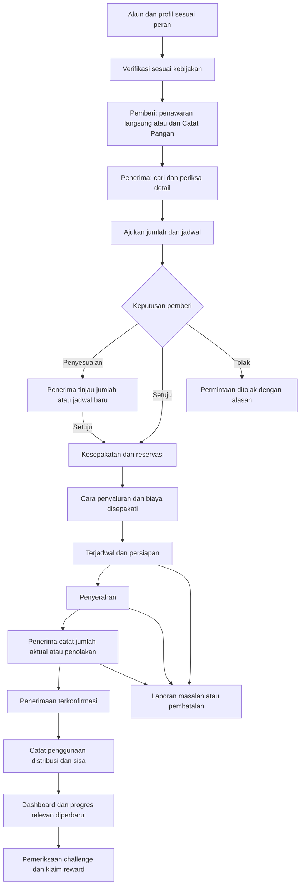

# Design Lestari Pangan

Versi 1.0 · 8 Oktober 2026 · Acuan untuk pembuatan UI dan prototipe interaktif.

**Arah yang disetujui:** aplikasi mobile dengan kualitas pengalaman startup, palet Kebun Hangat (hijau utama, oranye aksen, permukaan netral), serta interaksi dan motion yang halus. Dokumen ini menetapkan rancangan UI yang dapat langsung dikerjakan. Parameter bisnis yang masih terbuka tetap ditandai; rancangan layar tidak mengesahkan parameter tersebut.

## Daftar isi

1. [Dasar dan batas keputusan](#1-dasar-dan-batas-keputusan)
2. [Analisis produk dan kebutuhan pengguna](#2-analisis-produk-dan-kebutuhan-pengguna)
3. [Arah visual](#3-arah-visual)
4. [Token warna](#4-token-warna)
5. [Tipografi dan tata letak](#5-tipografi-dan-tata-letak)
6. [Komponen bersama](#6-komponen-bersama)
7. [Arsitektur informasi dan navigasi](#7-arsitektur-informasi-dan-navigasi)
8. [Inventaris layar](#8-inventaris-layar)
9. [Akun dan verifikasi](#9-akun-dan-verifikasi)
10. [Beranda dan penemuan pangan](#10-beranda-dan-penemuan-pangan)
11. [Penawaran dan permintaan](#11-penawaran-dan-permintaan)
12. [Penyaluran dan komunikasi](#12-penyaluran-dan-komunikasi)
13. [Catat Pangan dan distribusi](#13-catat-pangan-dan-distribusi)
14. [Dashboard dampak](#14-dashboard-dampak)
15. [Resep dan percakapan suara](#15-resep-dan-percakapan-suara)
16. [Tips Anti Food Waste](#16-tips-anti-food-waste)
17. [Eco Challenge dan reward](#17-eco-challenge-dan-reward)
18. [Pendanaan dan transparansi](#18-pendanaan-dan-transparansi)
19. [Akun bantuan dan privasi](#19-akun-bantuan-dan-privasi)
20. [Panel admin dan mitra pengiriman](#20-panel-admin-dan-mitra-pengiriman)
21. [Keadaan UI dan status kegiatan](#21-keadaan-ui-dan-status-kegiatan)
22. [Motion dan respons interaksi](#22-motion-dan-respons-interaksi)
23. [Aksesibilitas dan hak akses](#23-aksesibilitas-dan-hak-akses)
24. [Ketertelusuran dan pemeriksaan penerimaan](#24-ketertelusuran-dan-pemeriksaan-penerimaan)
25. [Urutan pembuatan UI dan keputusan terbuka](#25-urutan-pembuatan-ui-dan-keputusan-terbuka)
26. [Referensi](#26-referensi)

## 1. Dasar dan batas keputusan

### 1.1 Dokumen yang dianalisis

| Sumber | Peran dalam rancangan |
| --- | --- |
| [README.md](README.md) | Misi, pihak pengguna, enam fitur, prinsip donasi gratis, pendanaan, reward. |
| [REQUIREMENTS.md](REQUIREMENTS.md) v0.1 | Seluruh BR, FR, NFR, skenario AT-01–AT-12, dan keputusan OD-01–OD-10. |
| [CATATAN-KEPUTUSAN-PRODUK.md](CATATAN-KEPUTUSAN-PRODUK.md) | Pembeda keputusan pengguna, usulan, dua kelompok challenge, serta dua paket reward. |
| [RISET-UX-WARNA.md](RISET-UX-WARNA.md) | Peran warna, pasangan kontras, dan pemilihan palet yang kemudian disetujui pengguna. |
| `assets/logo-lestari-pangan.png` | Aset logo yang sudah tersedia; telah diperiksa secara visual. |
| Skill ui-ux-pro-max dan design-system | Pedoman navigasi mobile, komponen, motion, aksesibilitas, dan token. |

Dokumen use case `.docx` dirujuk oleh README/requirement; rancangan ini menggunakan penjabaran yang tersedia dalam dokumen proyek di atas, tanpa mengklaim pemeriksaan ulang berkas `.docx` tersebut. Sesuai arahan terbaru pengguna, **UI dirancang dari awal**; `UI.html` tidak menjadi acuan layout, komponen, navigasi, atau motion. Referensi lama dalam dokumen produk dibaca sebagai konteks historis.

### 1.2 Status rancangan

- **Disetujui pengguna:** palet hijau–oranye, arah mobile startup, keinginan motion halus, dan pembuatan acuan seluruh halaman.
- **Keputusan desain dalam dokumen ini:** navigasi lima tab, token, ukuran komponen, font, susunan layar, microcopy, pola transisi, dan contoh data prototipe. Ini dapat digunakan untuk memulai UI.
- **Asumsi prototipe:** permintaan dengan persetujuan pemberi; satu peran aktif per akun; penyaluran manual tanpa GPS langsung; panel admin web responsif. Asumsi ini dipakai agar prototipe dapat dijalankan dan dapat diganti setelah OD terkait ditetapkan.
- **Tetap terbuka:** login, dokumen verifikasi, masa reservasi, kebijakan pangan, pembayar ongkir, target challenge, poin, kuota hadiah, retensi suara, wilayah, platform rilis, dan target performa produksi.

Seluruh P0 dan P1 di requirement tercakup dalam desain. Prioritas menentukan urutan pengerjaan, bukan penghapusan halaman. P2 seperti GPS langsung, pencocokan otomatis, emisi, multi-cabang, dan otomatisasi publikasi tidak menjadi ketergantungan UI awal.

Framework, penyedia API, database, dan library animasi dipilih pada tahap `architecture.md`. Nama rute di dokumen ini adalah kontrak navigasi logis untuk desain, bukan kontrak endpoint.

## 2. Analisis produk dan kebutuhan pengguna

Lestari Pangan merupakan aplikasi koordinasi penyaluran dengan penemuan pangan, pencatatan, serta edukasi. Pola familiar dari marketplace digunakan untuk pencarian, filter, kartu, detail, dan pelacakan aktivitas. Isi serta tindakan mengikuti donasi dan kebutuhan penerima.

| Pengguna | Kebutuhan utama | Implikasi UX |
| --- | --- | --- |
| Restoran/UMKM | Menawarkan surplus cepat dan memeriksa permintaan | Penawaran langsung, draf, informasi pangan terstruktur, antrean permintaan, jadwal. |
| Rumah tangga | Menyalurkan atau menggunakan bahan yang tersedia | Formulir tanpa nama usaha wajib, Catat Pangan, resep teks/suara, tips kontekstual. |
| Pengelola panti/komunitas | Menilai kesesuaian dengan kebutuhan dan kemampuan menerima | Area, jumlah, jenis, penyimpanan, bahan/alergen, jadwal, pengambilan, penerimaan sebagian. |
| Admin | Menindaklanjuti antrean dan masalah serta memeriksa bukti | Tabel terfilter, detail terkait, alasan keputusan, riwayat, pembatasan wewenang. |
| Mitra pengiriman | Memahami tugas, waktu, dan serah terima | Antarmuka tugas ringkas atau koordinasi manual; akses hanya pada tugas terkait. |
| Pendukung/sponsor | Mengetahui tujuan dana dan hasil program | Dana terpisah per tujuan, status transaksi, laporan agregat sesuai hak akses. |

### 2.1 Prinsip pengalaman

1. Satu tindakan utama yang jelas per konteks layar. Aktivitas yang memerlukan tindakan mendahului konten inspirasi.
2. Penawaran, kesepakatan, penyerahan, penerimaan, dan distribusi terlihat sebagai tahap berbeda.
3. Jumlah selalu berdampingan dengan satuan; estimasi diberi label.
4. Batas pengambilan dan tanggal label tampil sebagai informasi berbeda. Foto, verifikasi akun, atau warna hijau tidak menjadi jaminan keamanan pangan.
5. Donasi pangan gratis; biaya pengiriman dan sumber pembayar tampil sebelum persetujuan. Dukungan finansial merupakan alur terpisah.
6. Data privat dibatasi sesuai pihak kegiatan. Persetujuan publikasi berdiri sendiri.
7. Pelaporan sisa, penolakan, dan kendala menggunakan bahasa netral; tidak menyalahkan pengguna.
8. UI memberikan respons segera, mempertahankan input saat gagal, dan mengonfirmasi hasil penting dari server.

### 2.2 Keputusan untuk rancangan UI baru

| Kebutuhan produk | Keputusan rancangan baru |
| --- | --- |
| Aktivitas dan penyaluran yang mudah diakses | Header ringkas, dekorasi terbatas, kegiatan perlu tindakan mudah ditemukan pada layar pertama. |
| Dampak yang dapat ditelusuri | Ringkasan per peran, sumber dan periode jelas; progres hanya untuk target yang didefinisikan. |
| Komponen yang konsisten | Ikon vektor dengan ukuran, stroke, dan label konsisten; tidak memakai emoji untuk kontrol. |
| Pencatatan stok, penggunaan, donasi, dan terbuang | Nama fitur **Catat Pangan**, bukan hanya catatan sisa. |
| Challenge yang aturannya belum final | Konten contoh diberi penanda data demo; aturan dan target sebenarnya mengikuti OD-05. |
| UI mobile adaptif | Safe area dan status bar sistem; kerangka ponsel hanya untuk presentasi desain. |

## 3. Arah visual

**Karakter:** modern, ramah, rapi, dekat dengan pangan, dan dapat dipercaya melalui informasi yang jelas. Permukaan dominan netral, kartu putih, hijau untuk tindakan dan pilihan aktif, oranye untuk sorotan apresiasi. Tidak ada klaim bahwa satu hue menjamin kenyamanan semua pengguna.

- Foto pangan menjadi informasi visual utama pada daftar/detail; tanpa foto tetap ada kartu yang lengkap.
- Radius moderat, ruang konsisten, hierarki teks tegas, shadow ringan, serta ikon sederhana.
- Satu banner informasi statis jika diperlukan; beranda tidak memakai carousel otomatis atau promosi berulang.
- Ilustrasi kecil untuk onboarding dan keadaan kosong; tidak menyaingi jumlah, jadwal, serta tindakan.
- Logo tersedia dipertahankan proporsinya. PNG sumber memiliki ruang transparan luas: siapkan varian presentasi dengan batas artwork yang tepat sebelum dipakai di header; jangan meregangkan atau mengetik ulang wordmark. Asset asli tetap menjadi rujukan.
- Header dapat memakai teks nama produk untuk aksesibilitas dan logo sebagai dekorasi jika keduanya setara. Tagline lengkap tampil di onboarding/tentang, bukan wajib di setiap layar.

Pencarian dan kartu terasa familiar seperti aplikasi startup, sedangkan CTA berbunyi “Tawarkan Pangan”, “Ajukan Permintaan”, dan “Konfirmasi Penerimaan”. Tidak ada keranjang belanja, harga pangan, flash sale, atau pembelian prioritas.

## 4. Token warna

### 4.1 Arsitektur token

Gunakan tiga lapisan: **primitive → semantic → component**. Contoh: `green.700 = #2E7D32` → `color.primary` → `button.primary.background`. Komponen merujuk token semantic/component, bukan hex lokal. Nama ini dapat dipetakan ke CSS variables, resource native, atau theme framework setelah arsitektur dipilih.

### 4.2 Tema terang utama

| Token semantic | Nilai | Penggunaan |
| --- | --- | --- |
| `color.primary` | `#2E7D32` | CTA utama, pilihan aktif, tautan tindakan. |
| `color.onPrimary` | `#FFFFFF` | Teks/ikon tombol hijau. |
| `color.primaryPressed` | `#256528` | Keadaan ditekan; tetap dapat dibaca. |
| `color.primaryContainer` | `#EAF5EC` | Panel hijau lembut dan pilihan tab aktif. |
| `color.onPrimaryContainer` | `#12212B` | Teks panel hijau. |
| `color.accent` | `#FFB74D` | Sorotan reward/apresiasi secara terbatas. |
| `color.onAccent` | `#12212B` | Teks/ikon di atas oranye. |
| `color.background` | `#F7F8FA` | Latar halaman. |
| `color.surface` | `#FFFFFF` | Kartu, sheet, dialog, formulir. |
| `color.textPrimary` | `#12212B` | Judul, angka, isi penting. |
| `color.textSecondary` | `#52605A` | Metadata, hint, placeholder yang dibaca. |
| `color.borderSubtle` | `#DCE3DE` | Pemisah/kartu dekoratif; bukan satu-satunya penanda kontrol. |
| `color.borderControl` | `#7A8780` | Batas input/checkbox jika diperlukan untuk mengenali kontrol. |
| `color.focus` | `#2E7D32` | Ring fokus pada permukaan terang. |
| `color.disabledBackground` | `#E2E8E4` | Tombol nonaktif; alasan nonaktif tampil terpisah. |
| `color.disabledForeground` | `#52605A` | Label nonaktif. |
| `color.successForeground` / `Container` | `#2E7D32` / `#EAF5EC` | Hasil terkonfirmasi, dengan ikon dan teks. |
| `color.warningForeground` / `Container` | `#92400E` / `#FFF4DB` | Menunggu penyesuaian, waktu perlu diperiksa. |
| `color.errorForeground` / `Container` | `#B42318` / `#FEF3F2` | Validasi, kegagalan, tindakan destruktif. |
| `color.infoForeground` / `Container` | `#1D4ED8` / `#EFF6FF` | Jadwal/proses, dengan teks yang spesifik. |
| `color.scrim` | `rgba(18,33,43,0.40)` | Latar modal awal; periksa hasil komposit pada layar nyata. |

Kontras warna solid dihitung lokal memakai rumus WCAG: putih/hijau **5,13:1**, putih/hijau ditekan **7,07:1**, teks utama/putih **16,43:1**, teks sekunder/latar **6,22:1**, teks gelap/oranye **9,49:1**, batas kontrol/putih **3,75:1**. Putih/oranye hanya **1,73:1**, sehingga tidak digunakan untuk label. Pasangan warna bukan bukti audit aksesibilitas seluruh aplikasi; opacity, foto, overlay, dan keadaan interaksi harus diperiksa saat UI dibuat.

### 4.3 Kesiapan tema gelap

> **Tidak berlaku sejak 13 Oktober 2026:** aplikasi hanya memakai tema terang (CATATAN-KEPUTUSAN-PRODUK.md). Bagian ini disimpan sebagai arsip.

Tema terang adalah baseline pembuatan UI. Varian gelap disiapkan sebagai rekomendasi desain; aktivasi dan cakupan rilis mengikuti keputusan platform. Jika diaktifkan, gunakan pengaturan Sistem/Terang/Gelap dan terapkan pada seluruh layar, sheet, notifikasi dalam aplikasi, serta grafik.

| Peran | Nilai gelap | Pasangan |
| --- | --- | --- |
| Background / surface | `#111914` / `#1A241D` | Teks utama `#E8EFEA`. |
| Teks sekunder | `#B6C3BB` | Surface gelap. |
| Primary / onPrimary | `#81C784` / `#12212B` | Tombol utama. |
| Primary pressed | `#6FB974` | OnPrimary gelap. |
| Primary container | `#213B27` | Foreground `#81C784`. |
| Accent / onAccent | `#FFB74D` / `#12212B` | Sorotan. |
| Border subtle / control | `#34463B` / `#829087` | Control/surface mencapai sekitar 4,79:1. |
| Warning | `#F0BE63` pada `#3B2C13` | Label peringatan. |
| Error | `#FFB4AB` pada `#3D201D` | Label masalah. |
| Info | `#B9CEFF` pada `#1B2D4A` | Label proses. |
| Disabled background / foreground | `#2A352E` / `#B6C3BB` | Kontrol nonaktif. |
| Focus / scrim | `#81C784` / `rgba(0,0,0,0.60)` | Fokus dan modal. |

Success memakai primary/primaryContainer gelap. Teks utama/background mencapai sekitar 15,32:1; onPrimary/primary 8,16:1. Jangan membalik warna foto atau memakai opacity rendah pada informasi penting.

## 5. Tipografi dan tata letak

### 5.1 Tipografi

**Inter** untuk heading dan body, bobot 400/500/600/700; fallback font sistem yang tersedia (misalnya sans-serif pada prototipe web). Satu keluarga menjaga konsistensi formulir dan dashboard. Font harus tersedia lokal/bundled pada UI final sehingga jaringan font tidak menahan render; pengemasan/lisensi diperiksa saat implementasi.

Angka ukuran berikut adalah unit desain logis; body diterjemahkan ke ukuran scalable native. Android memakai sp untuk teks dan dp untuk tata letak; iOS memakai pt dan dukungan Dynamic Type. Prototipe web menggunakan CSS px/rem sesuai viewport, bukan piksel fisik layar.

| Token | Ukuran / line height baseline | Bobot | Penggunaan |
| --- | --- | --- | --- |
| `type.display` | 28 / 36 | 700 | Onboarding, ringkasan besar yang singkat. |
| `type.pageTitle` | 24 / 32 | 700 | Judul halaman. |
| `type.sectionTitle` | 20 / 28 | 600 | Heading bagian. |
| `type.cardTitle` | 18 / 26 | 600 | Nama pangan/detail dan judul kartu besar. |
| `type.body` | 16 / 24 | 400 | Isi, formulir, resep, penjelasan. |
| `type.label` | 14 / 20 | 600 | Tombol, label field, tab. |
| `type.metadata` | 14 / 20 | 400 | Area, tanggal, sumber data. |
| `type.caption` | 12 / 18 | 500 | Informasi pendukung singkat; bukan jumlah/jadwal penting. |

Tombol utama dapat memakai 16/24. Angka statistik 28/36, dengan satuan dan periode terbaca. Hindari teks tipis, kapital penuh panjang, dan pemotongan nama pangan yang menghilangkan konteks. Nama kartu dapat dua baris; detail menampilkan nama lengkap. Label tombol membungkus dan menambah tinggi jika pembesaran font memerlukannya.

### 5.2 Ukuran, spacing, dan bentuk

| Token | Nilai awal | Penggunaan |
| --- | --- | --- |
| `space.1/2/3/4/5/6/8/10/12` | 4/8/12/16/20/24/32/40/48 | Rhythm dasar. |
| `layout.gutterCompact` | 16 | Lebar ponsel kecil. |
| `layout.gutterRegular` | 20 | Frame ponsel utama. |
| `layout.sectionGap` | 24 | Antarbagian. |
| `radius.input` / `button` | 12 / 12 | Kontrol. |
| `radius.card` / `sheet` / `dialog` | 16 / 24 / 20 | Permukaan. |
| `radius.chip` | 999 | Chip dengan label. |
| `icon.small/medium/large` | 20/24/32 | Vektor konsisten. |
| `elevation.card` | Border ringan atau shadow 0 2 8, warna gelap 6% | Salah satu penanda cukup. |
| `elevation.overlay` | Shadow 0 8 24, warna gelap 12% | Sheet/dialog. |

### 5.3 Frame dan adaptasi

- Frame utama desain: **390 × 844**; periksa 360 × 800, 375 × 812, dan 430 × 932. Ini ukuran prototipe logis, bukan daftar perangkat rilis.
- Lebar <360: layout satu kolom, kurangi gutter ke 16; jangan mengecilkan body atau target tap.
- Lebar <600: konten satu kolom. Kartu pangan daftar memakai thumbnail dan teks; grid opsional dua kolom hanya jika metadata tetap terbaca.
- Lebar 600–839: gutter 24, formulir maksimal 560, daftar/detail bisa dua panel jika ruang memungkinkan.
- Lebar ≥840: rail navigasi opsional, detail dua panel; admin menggunakan sidebar. Breakpoint ini keputusan desain awal, bukan batas platform wajib.
- Formulir panjang, resep, dan artikel membatasi lebar baca sekitar 640. Lanskap dan font besar dapat mengubah grid menjadi satu kolom.
- App bar baseline 56, bottom tab baseline 64 **ditambah safe area**; tidak dikunci jika teks membesar. CTA bawah baseline tinggi tombol 52 plus padding dan safe area.
- Konten mendapat inset sesuai tinggi app bar, tab bar, dan CTA aktual. Pada detail/formulir yang memiliki CTA sticky, bottom tab disembunyikan.
- Keyboard tidak boleh menutup input/error/CTA. Scroll ke field aktif; keyboard numerik untuk jumlah, tanpa menghilangkan label satuan. Tanggal/waktu memakai picker dan alternatif input yang aksesibel.

## 6. Komponen bersama

Gunakan ikon vektor dari satu keluarga: **Phosphor** sebagai arah visual, weight regular pada ikon antarmuka, ukuran 24 untuk navigasi. Icon selected dapat memakai fill sebagai penanda keadaan; jangan mencampur gaya tanpa alasan. Pilihan paket native mengikuti arsitektur. Emoji tidak dipakai sebagai ikon kontrol.

Target tap minimum: **48 × 48 dp di Android** dan **44 × 44 pt di iOS**; gunakan area 48 unit desain pada prototipe. Tinggi visual chip/ikon boleh lebih kecil dengan hit area yang tidak saling tumpang tindih. Tombol standar 52 dengan padding horizontal 16; tinggi bertambah untuk teks besar.

| ID komponen | Anatomi dan varian | Keadaan dan perilaku |
| --- | --- | --- |
| `AppBar` | Back, judul, maksimal dua aksi relevan | Back mempertahankan input/scroll; judul detail tidak ditutupi ikon. |
| `BottomTabBar` | Lima item berikon dan label; indikator pilihan | Aktif: primaryContainer + ikon/teks primary; state selected terbaca screen reader. |
| `PrimaryButton` | Label kerja spesifik; leading icon opsional | Default/pressed/loading/disabled/focus. Saat submit label menjadi “Mengirim…”; lebar tetap, cegah kirim ganda. |
| `SecondaryButton` | Outline control + teks; atau tonal | Untuk aksi pendamping. Tidak menandingi primary. |
| `DestructiveAction` | Teks error atau tombol error pada konfirmasi | Alasan dan konsekuensi ditampilkan; tidak hanya ikon tempat sampah. |
| `TextField` | Label permanen, input, hint, error | Kosong/focus/filled/error/read-only/disabled. Input tersimpan ketika submit gagal. |
| `QuantityField` | Input desimal, satuan, estimasi, batas tersedia | Stepper tidak wajib; porsi/unit bulat jika kebijakan mengharuskan; keyboard/paste tetap didukung. |
| `DateTimeField` | Tanggal, waktu, zona lokasi | Batas pengambilan terpisah dari tanggal label; tampil absolut. |
| `SearchBar` | Ikon pencarian, placeholder, clear | Submit keyboard, loading hasil, tanpa hasil, hapus query; filter tetap tersimpan. |
| `FilterChip` | Label, selected/check, remove opsional | Hit area cukup, count filter aktif; selection tidak hanya warna. |
| `FoodCard` | Foto 96 × 96 atau placeholder; nama; jumlah+satuan; area; jadwal; badge | Thumbnail crop proporsional; daftar receiver hanya tersedia; kartu donor punya status dan ringkasan permintaan. |
| `ActivityCard` | Jenis aktivitas, counterpart berizin, jumlah, status, waktu, aksi berikutnya | Membawa ID kegiatan yang konsisten; perlu tindakan mendahului riwayat. |
| `StatusBadge` | Ikon + label, container semantic | Variasi status tercantum bagian 21; jumlah/teks tetap terbaca tanpa warna. |
| `KeyValueRow` | Label/value, value multiline | Untuk bahan/alergen, penyimpanan, biaya, dan informasi tidak diketahui. |
| `Timeline` | Tahap, waktu, pelaku/sumber, status, alasan | Bukan persentase palsu; tahap gagal/ditolak berbeda; distribusi terpisah dari diterima. |
| `MetricCard` | Angka, satuan, periode, sumber, completeness | Tanpa data memakai “Belum ada data”; estimasi diberi label. |
| `ChartPanel` | Judul, periode/satuan, grafik, legend, tabel nilai | Warna + pola/label; nol dan missing berbeda; hindari animasi angka berulang. |
| `ProgressCard` | Target, nilai aktual, periode, aturan, status pemeriksaan | Tidak tampil persentase tanpa denominator; demo target ditandai. |
| `VoiceControl` | Mic, label keadaan, hentikan, ulangi, teks | Aktif/mendengarkan/memproses/berbicara/error; tidak merekam tanpa tindakan/izin. |
| `UploadField` | Tujuan, pilih file/kamera sesuai izin, preview, hapus | Optional/required sesuai konfigurasi; progress, gagal, retry; tidak mengirim foto wajah sebagai default. |
| `BottomSheet` | Judul, close, konten, aksi | Filter/pilih satuan/metode; swipe dan tombol tutup; expanded untuk konten panjang. |
| `Dialog` | Judul konkret, konsekuensi, batal/konfirmasi | Hanya untuk keputusan singkat penting; fokus berada dalam dialog dan kembali ke pemicu. |
| `Snackbar` | Pesan singkat, aksi opsional | Untuk hasil ringan; keputusan penting tetap tampil di halaman, tanpa bergantung timeout. |
| `StatePanel` | Ikon/ilustrasi kecil, judul, penjelasan, aksi | Empty/error/forbidden/unavailable; judul spesifik dan solusi relevan. |
| `Skeleton` | Bentuk mengikuti konten, tinggi stabil | Hindari skeleton acak dan shimmer pada reduced motion. |

Foto opsional, data loading, dan metadata panjang harus memiliki varian komponen. Klik kartu dan tombol di dalamnya memiliki hit area/label terpisah, tanpa nested tindakan yang ambigu. Semua field punya label di luar placeholder.

## 7. Arsitektur informasi dan navigasi

### 7.1 Lima tab mobile

| Tab | Pemberi | Penerima |
| --- | --- | --- |
| **Beranda** | Aktivitas perlu tindakan, Tawarkan Pangan, ringkasan, pintasan | Jadwal penerimaan, Cari Pangan, penawaran area, ringkasan. |
| **Donasi** | Penawaran Saya: Aktif, Draf, Selesai; buat penawaran | Cari Pangan: search, filter, area, daftar/detail. |
| **Pangan** | Catat Pangan, persediaan, pergerakan, tawarkan dari catatan | Pangan diterima, penggunaan/distribusi, sisa/terbuang. |
| **Aktivitas** | Permintaan masuk, jadwal, konfirmasi, riwayat | Permintaan saya, jadwal, penerimaan, laporan distribusi. |
| **Akun** | Profil, verifikasi, konten tersimpan, challenge/reward, pendanaan, bantuan | Profil kebutuhan, verifikasi, konten tersimpan, challenge/reward, pendanaan, bantuan. |

Resep, Tips, Eco Challenge, dan Dashboard Dampak dapat ditemukan dari pintasan beranda serta menu Akun. Notifikasi pada app bar menuju daftar pemberitahuan; koordinasi dibuka dari detail aktivitas. Tidak menambah tab untuk tiap fitur.

Label **Pangan** adalah label tab pendek; judul halamannya tetap **Catat Pangan**. Akun menampilkan peran aktif secara eksplisit. Pergantian peran hanya muncul jika kebijakan multi-peran disetujui OD-02; prototipe memperlihatkan kedua peran melalui pemilih skenario developer yang tidak menjadi menu produk.

### 7.2 Aturan navigasi

- Setiap tab mempertahankan stack, query/filter, dan posisi scroll. Tapping tab lain tidak menghapus draf.
- Halaman detail membuka substack dengan back; formulir bertahap memiliki back ke langkah sebelumnya.
- Root tab menampilkan bottom navigation. Detail, penyerahan, formulir, resep percakapan, dan checkout dukungan menggunakan app bar + CTA/context control; bottom tab disembunyikan.
- Filter, satuan, sort, pilihan penyaluran pendek menggunakan sheet. Formulir verifikasi/penawaran panjang memakai halaman penuh.
- Deep link notifikasi membuka entitas yang benar setelah autentikasi; recheck hak akses dan status terbaru. Entitas ditutup/tidak berizin memiliki StatePanel yang sesuai.
- Setelah submit terkonfirmasi: pindah ke detail entitas baru, dengan status dan langkah berikutnya. Tidak me-reset seluruh tab ke beranda.
- Unsaved form: sheet “Simpan draf / Lanjut mengedit / Buang perubahan” jika draf didukung; untuk form lain “Lanjut mengedit / Buang perubahan”.

### 7.3 Peta alur pusat



Alur persetujuan merupakan asumsi prototipe OD-01. Reservasi, jadwal, sponsor, serta kapan informasi alamat dibuka ditentukan oleh kebijakan dan hak akses, bukan oleh transisi visual.

## 8. Inventaris layar

ID menjadi nama frame dan referensi handoff. `{id}` berarti entitas terkait. Sheet/dialog menggunakan suffix rute logis atau state; tidak harus menjadi route terpisah dalam implementasi. Semua layar mewarisi state umum bagian 21 dan aksesibilitas bagian 23. Inventaris ini mencakup halaman, subhalaman, dan overlay yang dibutuhkan, bukan jumlah screenshot final.

### 8.1 Masuk, profil awal, dan beranda

| ID / rute logis | Layar dan akses | Isi/tindakan utama |
| --- | --- | --- |
| U01 `/launch` | Launch · semua | Logo sistem, pemulihan sesi, route ke masuk/beranda; retry jika pemulihan gagal. |
| U02 `/onboarding` | Pengenalan · belum masuk | Misi, memberi/menerima, donasi gratis; “Mulai”, “Masuk”; maksimal tiga slide manual. |
| U03 `/auth/login` | Masuk · belum masuk | Identifier dan kontrol autentikasi sesuai OD-02, bantuan pemulihan; “Masuk”. |
| U04 `/auth/register` | Daftar · belum masuk | Identitas akses, persetujuan ketentuan/privasi yang diperlukan; “Buat akun”. |
| U05 `/auth/verify` | Konfirmasi akses · bersyarat | Kode/link sesuai metode terpilih, kirim ulang, ubah kontak; kode bukan keputusan login final. |
| U06 `/auth/recover` | Pulihkan akses · belum masuk | Kontak, petunjuk dan hasil pemulihan; “Lanjutkan”. |
| U07 `/setup/role` | Peran/tipe · akun baru | Pemberi: restoran/UMKM/rumah tangga; penerima: panti/komunitas; “Lanjutkan”. |
| U08 `/setup/donor` | Profil pemberi · pemberi | Identitas, penanggung jawab, area, alamat privat, jam; “Simpan profil”. |
| U09 `/setup/recipient` | Profil penerima · penerima | Organisasi, pengelola, kebutuhan, kapasitas, penyimpanan, jadwal, kemampuan mengambil. |
| U10 `/account/verification/submit` | Pengajuan bukti · kedua peran | Checklist persyaratan kebijakan, upload privat, tinjau; “Kirim untuk ditinjau”. |
| U11 `/account/verification` | Status verifikasi · pemilik | Status, alasan, data diminta, riwayat; “Perbaiki pengajuan” jika relevan. |
| H01 `/home` | Beranda pemberi · pemberi | Aktivitas penting, “Tawarkan Pangan”, pintasan, ringkasan dampak. |
| H02 `/home` | Beranda penerima · penerima | Area, jadwal penerimaan, “Cari Pangan”, penawaran dan ringkasan. |
| H03 `/home/features` | Semua fitur · kedua peran | Enam modul, dukungan/bantuan; urutan berdasarkan tugas. |
| H04 `/area/select` | Pilih area · kedua peran | Cari wilayah/manual atau izin lokasi kontekstual; “Gunakan area ini”. |

### 8.2 Penawaran dan permintaan

| ID / rute logis | Layar dan akses | Isi/tindakan utama |
| --- | --- | --- |
| D01 `/donations/mine` | Penawaran Saya · pemberi | Tab Aktif/Draf/Selesai, filter, jumlah tersedia; “Tawarkan Pangan”. |
| D02 `/donations/new` | Form penawaran · pemberi | Tiga langkah: pangan, penyaluran, tinjauan; draf; “Terbitkan penawaran”. |
| D03 `/donations/{id}/manage` | Detail milik saya · pemberi pemilik | Pangan, jumlah terpisah, permintaan, jadwal; “Lihat permintaan”, edit/tutup. |
| D04 `/donations/{id}/edit` | Edit/perubahan penting · pemilik | Nilai lama/baru, pihak terdampak; “Kirim perubahan” jika perlu tinjauan. |
| D05 `/donations/{id}/close` | Tutup penawaran · pemilik, dialog | Alasan, pengaruh permintaan aktif; “Tutup penawaran” sesuai kebijakan. |
| D06 `/donations` | Cari Pangan · penerima | Search, area, filter, daftar tersedia; tap detail. |
| D07 `/donations/filters` | Filter/sort · penerima, sheet | Jenis, area/jarak bila tersedia, waktu, jumlah+satuan; “Terapkan”. |
| D08 `/donations/{id}` | Detail pangan · penerima berizin | Foto opsional, jumlah, penyimpanan, bahan/alergen, waktu, area; “Ajukan Permintaan”. |
| D09 `/partners/{id}` | Profil publik mitra · berizin | Nama/tipe/area, info relevan, apresiasi yang disetujui; tanpa alamat/dokumen privat. |
| Q01 `/donations/{id}/request` | Ajukan permintaan · penerima | Jumlah, jadwal, kemampuan, cara penyaluran; tinjauan lalu “Kirim permintaan”. |
| Q02 `/requests/{id}` | Detail permintaan · pihak terkait | Jumlah, keputusan, alasan, kesepakatan; aksi mengikuti state. |
| Q03 `/requests/incoming` | Permintaan masuk · pemberi | Antrean per penawaran, kebutuhan/kapasitas; pilih permintaan. |
| Q04 `/requests/{id}/review` | Tinjau permintaan · pemberi | Jumlah tersedia, profil kapasitas, jadwal; setujui/ajukan penyesuaian/tolak. |
| Q05 `/requests/{id}/adjustment` | Tinjau penyesuaian · penerima | Nilai lama/baru, alasan; “Setujui penyesuaian” atau “Tolak penyesuaian”. |
| Q06 `/requests/{id}/cancel` | Batalkan permintaan · pihak berizin | Alasan, reservasi/biaya/kebijakan; konfirmasi pembatalan. |

### 8.3 Aktivitas, penyaluran, notifikasi, dan masalah

| ID / rute logis | Layar dan akses | Isi/tindakan utama |
| --- | --- | --- |
| L01 `/activities` | Aktivitas · kedua peran | Perlu tindakan/Berjalan/Riwayat; subfilter permintaan/penyaluran/laporan. |
| L02 `/transfers/{id}` | Detail penyaluran · pihak terkait | Kesepakatan, status/timeline, cara, biaya, jadwal, kontak berizin, next action. |
| L03 `/transfers/{id}/method` | Metode/jadwal/biaya · pihak terkait | Ambil sendiri/antar pemberi/mitra jika tersedia, pembayar/sponsor, aturan; “Setujui”. |
| L04 `/transfers/{id}/prepare` | Persiapan · pemberi | Ringkasan informasi pangan dan pengemasan yang ditinjau; “Catat penyerahan”. |
| L05 `/transfers/{id}/handover` | Penyerahan · pihak berizin | Jumlah aktual diserahkan, metode bukti/kode bersyarat; “Konfirmasi penyerahan”. |
| L06 `/transfers/{id}/receive` | Konfirmasi penerimaan · penerima | Jumlah diterima/ditolak, kondisi, alasan, tinjauan; “Konfirmasi penerimaan”. |
| L07 `/transfers/{id}/delivery` | Status pengiriman · pihak terkait | Timeline sumber manual/mitra, jadwal, biaya, kendala; koordinasi/lapor. |
| L08 `/activities/{id}/coordinate` | Koordinasi · pihak terkait | Chat atau kontak terbatas sesuai OD-09; header konteks kegiatan. |
| L09 `/notifications` | Notifikasi · pemilik | Filter kegiatan/reward/sistem; baca dan deep link entitas. |
| L10 `/issues/new` | Laporan masalah · pihak terkait | Kategori, kegiatan, alasan, lampiran opsional; “Kirim laporan”. |
| L11 `/issues/{id}` | Detail/tindak lanjut masalah · pihak berizin | Status, kronologi, alasan keputusan, aksi tindak lanjut/keberatan. |

### 8.4 Catatan, distribusi, dan dampak

| ID / rute logis | Layar dan akses | Isi/tindakan utama |
| --- | --- | --- |
| C01 `/food` | Catat Pangan · pemilik | Stok/status/filter kategori, sumber penerimaan; “Catat Pangan” atau “Catat hasil penerimaan”. |
| C02 `/food/new` | Tambah catatan · kedua peran | Nama, kategori, jumlah/satuan, estimasi, tanggal, penyimpanan; “Simpan catatan”. |
| C03 `/food/{id}` | Detail catatan · pemilik | Saldo dan pergerakan, penawaran/penerimaan asal, tindakan penggunaan/distribusi. |
| C04 `/food/{id}/movement` | Catat pergerakan · pemilik | Jenis, jumlah, tanggal, alasan terbuang jika relevan; tinjauan lalu simpan. |
| C05 `/food/{id}/edit` | Koreksi catatan · pemilik/berwenang | Sebelum/sesudah, alasan, riwayat; “Simpan koreksi” atau “Ajukan koreksi”. |
| C06 `/transfers/{id}/distribution` | Laporan penggunaan/distribusi · penerima | Jumlah dipakai/didistribusikan/terbuang, sisa dihitung, alasan; “Simpan laporan”. |
| I01 `/impact` | Dashboard dampak · kedua peran | Periode, satuan, metric per peran, tren, kelengkapan dan sumber. |
| I02 `/impact/history` | Riwayat dampak · pemilik | Kegiatan terhubung, status konfirmasi, koreksi; tap sumber. |
| I03 `/impact/method` | Penjelasan data · berizin | Definisi ukuran, konversi jika ada, estimasi, batas perbandingan. |

### 8.5 Resep, tips, challenge, dan reward

| ID / rute logis | Layar dan akses | Isi/tindakan utama |
| --- | --- | --- |
| R01 `/recipes` | Resep dari Sisa · kedua peran | Bahan, porsi, alat, preferensi/alergi; “Cari resep”, “Bicara dengan asisten”. |
| R02 `/recipes/results` | Pilihan resep · kedua peran | Kecocokan bahan, bahan tambahan, sumber/adaptasi; pilih detail. |
| R03 `/recipes/conversation` | Percakapan suara/teks · pemilik sesi | Status audio, transkrip jika tersedia, klarifikasi, hasil tertulis, stop/ulangi/mode teks. |
| R04 `/recipes/{id}` | Detail resep · berizin | Sumber, porsi, bahan dimiliki/tambahan, langkah; simpan dan mulai memasak. |
| R05 `/recipes/{id}/steps` | Langkah memasak · kedua peran | Langkah bernomor, sebelumnya/berikutnya, bacakan opsional; tanpa gesture wajib. |
| R06 `/recipes/saved` | Resep tersimpan · pemilik | Search/daftar; konten ditarik memiliki penjelasan. |
| R07 `/recipes/{id}/usage` | Konfirmasi bahan digunakan · pemilik stok | Pilih catatan, jumlah aktual/satuan; “Catat penggunaan”. |
| T01 `/tips` | Tips Anti Food Waste · kedua peran | Kategori, search, konten sesuai peran; pilih artikel. |
| T02 `/tips/{id}` | Artikel tips · berizin | Teks, sumber/versi/tanggal peninjauan bila tersedia; simpan. |
| T03 `/tips/saved` | Tips tersimpan · pemilik | Daftar/search, empty, konten diperbarui/ditarik. |
| E01 `/challenges` | Eco Challenge · kedua peran | Sesuai peran, tersedia/diikuti/riwayat; tanpa leaderboard kilogram. |
| E02 `/challenges/{id}` | Detail challenge · peserta layak | Tujuan, periode, aturan, bukti, reward/kuota; “Ikuti challenge”. |
| E03 `/challenges/{id}/progress` | Progres/bukti · peserta | Aktivitas relevan, sumber, pemeriksaan, koreksi; bukti non-wajah opsional sesuai aturan. |
| E04 `/rewards` | Katalog reward · peserta layak | Paket/barang, kelayakan, stok, cara/biaya; pilih satu reward. |
| E05 `/rewards/{id}` | Detail reward · peserta layak | Isi dan batas paket, nilai jika pasti, sponsor, periode, stok. |
| E06 `/reward-claims/new` | Tinjauan klaim · peserta terverifikasi | Hak klaim, satu pilihan, biaya/alamat privat; “Ajukan klaim”. |
| E07 `/reward-claims/{id}` | Status klaim/penyerahan · pemilik | Timeline pemeriksaan, pengambilan/kirim, alasan, konfirmasi diterima/keberatan. |
| E08 `/appreciations/{id}/review` | Pratinjau apresiasi · mitra pemilik | Nama/logo/foto/caption/kanal/periode/versi; setujui publikasi atau minta revisi. |
| E09 `/appreciations/{id}` | Materi/sertifikat · mitra pemilik | Versi disetujui, periode kontribusi, unduh/share setelah tindakan pengguna. |

### 8.6 Pendanaan, akun, dan bantuan

| ID / rute logis | Layar dan akses | Isi/tindakan utama |
| --- | --- | --- |
| F01 `/support` | Dukung Lestari Pangan · berizin | Tujuan dana dan laporan; sekali/rutin/barang-jasa sesuai kemampuan program. |
| F02 `/support/contribute` | Form dukungan · pendukung | Tujuan, jumlah, frekuensi bila didukung, biaya, metode; “Tinjau dukungan”. |
| F03 `/support/review` | Tinjauan pembayaran · pendukung | Total, alokasi, biaya, ketentuan, sumber pembayaran; lanjut ke metode tersedia. |
| F04 `/contributions/{id}` | Status/bukti transaksi · pemilik | Menunggu/berhasil/gagal/pengembalian, referensi, retry terkontrol. |
| F05 `/contributions` | Riwayat dukungan · pemilik | Filter tujuan/status/periode, bukti transaksi. |
| F06 `/transparency` | Transparansi dana · berizin | Operasional/pengiriman/bantuan/barang-jasa, pengeluaran/saldo/periode. |
| F07 `/programs/{id}/report` | Detail laporan program · hak sesuai program | Agregat hasil terverifikasi, dana masuk/pakai/sisa, metode; tanpa dokumen privat. |
| F08 `/support/in-kind` | Dukungan barang/jasa · pendukung | Jenis, kapasitas, area, kontak privat, tinjauan admin; “Ajukan dukungan”. |
| F09 `/support/recurring` | Kelola dukungan rutin · bersyarat | Jadwal/status/alokasi, cara berhenti atau pengingat manual; bergantung OD-08. |
| A01 `/account` | Akun · pemilik | Profil/peran/verifikasi, menu modul, pengaturan, bantuan, keluar. |
| A02 `/account/profile` | Edit profil · pemilik | Varian pemberi/penerima, publik/privat jelas; “Simpan profil”. |
| A03 `/account/needs` | Kebutuhan dan kapasitas · penerima | Jenis pangan, kapasitas per satuan, penyimpanan, jadwal, kemampuan mengambil. |
| A04 `/account/locations` | Lokasi dan koordinasi · pemilik | Area publik, alamat/kontak privat, jam; “Simpan”. |
| A05 `/settings` | Pengaturan · pemilik | Notifikasi, izin, tampilan jika tersedia, privasi, keamanan akses. |
| A06 `/settings/notifications` | Preferensi notifikasi · pemilik | Kategori/izin OS, riwayat tetap tersedia; simpan preferensi. |
| A07 `/settings/privacy` | Data dan privasi · pemilik | Visibilitas, izin, kebijakan, rekaman/transkrip, permintaan penghapusan. |
| A08 `/settings/security` | Keamanan akses · pemilik | Metode akses terpilih, ubah/pulihkan bila tersedia, keluar; verifikasi ulang bersyarat. |
| A09 `/help` | Pusat bantuan · kedua peran | FAQ per tugas, pencarian, hubungi bantuan lewat kanal yang ditetapkan. |
| A10 `/help/contact` | Permintaan bantuan · pemilik | Topik, kegiatan opsional, pesan/lampiran; “Kirim bantuan”. |
| A11 `/legal/{type}` | Tentang/ketentuan/privasi · semua | Dokumen versi/tanggal, misi, kontak dukungan; konten legal disiapkan operasional. |
| A12 `/account/data-request` | Permintaan penghapusan · pemilik | Cakupan, konsekuensi, status proses sesuai kebijakan; “Ajukan permintaan”. |

### 8.7 Admin dan pengiriman

Admin merupakan fungsi pendukung dengan shell terpisah. Sponsor tidak otomatis mendapat akun admin. Layar mitra di bawah bersyarat: jika koordinasi pengiriman manual saja, kemampuan setara dijalankan admin dan L02/L07 tanpa membangun aplikasi kurir terpisah.

| ID / rute logis | Layar | Isi/tindakan utama |
| --- | --- | --- |
| AD01 `/admin/login` | Masuk admin | Identitas akses berwenang, bantuan pemulihan, kontrol sesuai OD-02. |
| AD02 `/admin` | Dashboard operasi | Antrean verifikasi, permintaan bermasalah, penyaluran perlu tindak lanjut, saldo per tujuan. |
| AD03 `/admin/users` | Pengguna/verifikasi | Search/filter peran/status; pilih akun. |
| AD04 `/admin/users/{id}` | Detail pemeriksaan | Profil, bukti berizin, alasan/riwayat; setujui/minta perbaikan/tolak/tangguhkan. |
| AD05 `/admin/transfers` | Penawaran dan penyaluran | Filter status/waktu/area, reservasi, kebutuhan konfirmasi; buka detail. |
| AD06 `/admin/transfers/{id}` | Detail operasi/koreksi | Penawaran → permintaan → pengiriman → penerimaan → distribusi; koreksi beralasan. |
| AD07 `/admin/issues` | Antrean kendala | Kategori/status/usia kasus; pilih laporan. |
| AD08 `/admin/issues/{id}` | Penanganan masalah | Kronologi, pihak, bukti berizin, keputusan/tindak lanjut; tanpa hapus jejak asal. |
| AD09 `/admin/deliveries` | Penugasan pengiriman | Jadwal, mitra, biaya/pembayar, status sumber; buat/ubah tugas sesuai kewenangan. |
| AD10 `/admin/content` | Tips/resep | Draf/review/terbit/ditarik, versi, reviewer. |
| AD11 `/admin/content/{id}/edit` | Editor dan review konten | Isi, sumber, status adaptasi, tanggal peninjauan; preview/review/terbit/tarik. |
| AD12 `/admin/challenges` | Challenge | Peran, periode, aturan, versi, kapasitas reward; list/create/edit melalui editor. |
| AD13 `/admin/challenges/{id}/edit` | Editor challenge | Target/bukti/aturan peserta/reward; preview dan publikasi versi. |
| AD14 `/admin/challenge-reviews/{id}` | Pemeriksaan pencapaian | Aktivitas terhubung, validitas, koreksi, alasan; setujui/minta perbaikan/tolak. |
| AD15 `/admin/rewards` | Katalog/stok reward | Paket, sponsor, kuota/nilai, ketersediaan; editor modal/halaman untuk konfigurasi. |
| AD16 `/admin/reward-claims/{id}` | Klaim/penyerahan | Hak, duplikasi, stok, biaya, pengiriman/terima, keberatan. |
| AD17 `/admin/appreciations/{id}` | Materi apresiasi | Penyusunan, versi persetujuan, kanal/periode; kirim pratinjau/catat publikasi berizin. |
| AD18 `/admin/funds` | Dana/transaksi | Sumber/tujuan/status, referensi, rekonsiliasi, barang-jasa terpisah. |
| AD19 `/admin/funds/{id}` | Detail pemasukan/pengeluaran | Bukti berizin, tanggal, alokasi, persetujuan, pengembalian; editor sesuai hak. |
| AD20 `/admin/programs` | Program/sponsor | Wilayah, periode, anggaran, alokasi ongkir, laporan; editor dan detail program. |
| AD21 `/admin/reports` | Laporan dana/dampak | Periode, satuan/sumber, kelengkapan, preview ekspor sesuai hak akses. |
| AD22 `/admin/audit` | Riwayat perubahan | Pelaku, waktu, entitas, sebelum/sesudah, alasan; read-only berizin. |
| K01 `/courier/tasks` | Tugas mitra · bersyarat | Tugas saya, jadwal, status; pilih tugas. |
| K02 `/courier/tasks/{id}` | Detail tugas · petugas terkait | Jumlah/satuan, lokasi/kontak berizin, waktu, biaya, instruksi; mulai/koordinasi. |
| K03 `/courier/tasks/{id}/handover` | Ambil/serahkan · petugas terkait | Bukti sesuai kebijakan, waktu/sumber/jumlah; catat ambil atau serah. |
| K04 `/courier/tasks/{id}/issue` | Kendala tugas · petugas terkait | Kategori/alasan, waktu/lampiran opsional; kirim laporan. |

## 9. Akun dan verifikasi

### 9.1 U01–U07: akses dan pemilihan peran

Launch hanya tampil selama pemulihan sesi/boot sistem yang diperlukan, tanpa durasi tunggu buatan. Onboarding dapat dilewati, maksimal tiga halaman manual: misi, bagaimana memberi/menerima, dan catatan penyaluran. Aksi akhir “Mulai”; tautan “Sudah punya akun? Masuk”. Tidak meminta mikrofon/lokasi pada pembukaan pertama.

U03–U06 merupakan template akses yang mengakomodasi password, OTP, atau link sesuai OD-02. Untuk prototipe gunakan varian identifier + langkah konfirmasi akses berlabel **metode demo**, tanpa menjanjikan dukungan provider tertentu. Saat metode produksi dipilih, hanya tampilkan field/control yang diperlukan.

- Label input tetap terlihat; dukung autofill, paste, password manager jika relevan, dan opsi lihat password.
- Kesalahan field tetap di dekat field; kesalahan submit menampilkan ringkasan dan fokus ke bagian yang perlu diperbaiki.
- Kode salah/kedaluwarsa punya petunjuk dan kirim ulang; countdown hanya jika batas server tersedia. Tidak memilih sendiri masa kode.
- Pemulihan memberi respons netral untuk melindungi informasi akun, lalu instruksi sesuai kanal yang ditetapkan.
- Role selector: dua kartu radio berdeskripsi “Saya menawarkan pangan” dan “Saya mencari pangan untuk panti/komunitas”; subtipe tampil setelah pilihan. Pilihan tidak hanya warna.

### 9.2 U08–U09 dan A02–A04: profil

| Kelompok field | Pemberi | Penerima | Perilaku |
| --- | --- | --- | --- |
| Identitas | Nama pengguna/usaha, tipe pemberi | Nama panti/komunitas, tipe organisasi | Rumah tangga tidak wajib nama usaha. |
| Penanggung jawab | Nama/kontak operasional | Pengelola/kontak | Jelaskan akses privat. |
| Wilayah | Area umum | Area layanan | Pilih manual tersedia tanpa lokasi OS. |
| Lokasi rinci | Alamat serah terima | Alamat penerimaan | Tidak masuk profil publik; akses terkait kegiatan. |
| Jam/jadwal | Jam koordinasi/pengambilan | Jadwal penerimaan | Hari dan zona waktu lokasi. |
| Kebutuhan | Tidak wajib bagi pemberi | Jenis pangan, kapasitas dan satuan, penyimpanan, kemampuan mengambil | Kapasitas per satuan, bukan menjumlah unit berbeda. |

Tanda “Wajib” ditentukan konfigurasi kebijakan; field yang tidak relevan disembunyikan, bukan diisi nilai palsu. Preview informasi publik tersedia sebelum simpan. Perubahan profil tidak diam-diam mengubah kesepakatan penyaluran yang sudah ada; tampilkan ajakan meninjau kegiatan terkait bila diperlukan.

### 9.3 U10–U11: pemeriksaan identitas

Susunan: judul → tujuan pemeriksaan → checklist berkas sesuai tipe/kebijakan → upload dengan penjelasan siapa yang melihat → tinjauan → submit. Tidak menetapkan jenis identitas atau foto wajib sebelum OD-02 selesai.

| State | Konten | Aksi |
| --- | --- | --- |
| Belum diajukan | Persyaratan dan manfaat pemeriksaan | “Mulai pengajuan”. |
| Mengunggah | Progress berkas dan tombol batal/retry | Jangan mengizinkan submit berkas belum selesai. |
| Sedang ditinjau | Waktu pengajuan, info proses | Buka data terkirim/bantuan; tanpa janji durasi yang belum pasti. |
| Perlu perbaikan | Field/berkas diminta dan alasan | “Perbaiki pengajuan”. |
| Disetujui | “Identitas telah diperiksa” | Lanjutkan kegiatan yang diizinkan. |
| Ditolak/ditangguhkan | Alasan yang dapat dibagikan dan tindak lanjut | Bantuan/ajukan ulang/keberatan jika kebijakan mengizinkan. |

Badge verifikasi mengacu pemeriksaan identitas; tidak berbunyi “Pangan dijamin aman”. Pembatasan membuat/menyetujui kegiatan mengikuti izin server. Prototype dapat memperlihatkan varian verifikasi berbeda tanpa memilih kebijakan akses produksi.

## 10. Beranda dan penemuan pangan

### 10.1 H01 beranda pemberi

Urutan dari atas ke bawah:

1. App bar: wordmark ringkas, notifikasi dengan jumlah belum dibaca jika tersedia.
2. Sapaan botanical, peran/tipe, area koordinasi dan label demo jika memakai data contoh.
3. **Perlu tindakan:** permintaan baru/perubahan/jadwal atau konfirmasi belum selesai, menyatu di dalam modul sapaan. Jika kosong, hilangkan strip tersebut.
4. CTA **Tawarkan Pangan**, dengan link pendamping “Dari Catat Pangan”.
5. Empat pintasan berilustrasi: Catat Pangan, Dampak, Resep, Semua fitur. Tips dan Eco Challenge ditemukan di bagian Inspirasi untukmu atau Semua fitur.
6. Penawaran aktif maksimum tiga kartu + “Lihat semua”, berisi foto pangan, jumlah tersedia, jadwal absolut dan area.
7. Ringkasan periode dalam kartu dampak ringkas: misalnya “10 porsi diterima penerima · Oktober 2026 · terkonfirmasi”; sumber dan link ke dashboard. Tidak memakai satu angka universal “diselamatkan” yang mencampur laporan.
8. Bagian **Inspirasi untukmu**: satu tips relevan dengan foto editorial; satu kartu challenge ringkas jika tersedia/diikuti. Dukungan platform melalui Akun atau kartu kecil tanpa menekan pengguna.

Acuan visual home terkunci v1: [GAYA-HOME-TERKUNCI.md](GAYA-HOME-TERKUNCI.md). Home memakai gutter 16 px dan ritme antarmodul 16–24 px; header/navigasi mengikuti tinggi teks. Screen lain belum dibuat ulang pada tahap penguncian ini.

Jika profil belum lengkap, tampilkan kartu penyelesaian berisi langkah tersisa; jangan menggantikan seluruh beranda dengan iklan onboarding. Jika belum ada aktivitas, beri contoh penggunaan singkat dan CTA pertama.

### 10.2 H02 beranda penerima

Urutan: header/notifikasi → area layanan dan ubah area → penerimaan terjadwal/perlu konfirmasi → search pangan → pintasan Pangan diterima/Dampak/Resep/Tips → daftar penawaran yang tersedia → ringkasan → challenge/tips.

Gunakan satu kartu jadwal terdekat dengan tombol “Lihat penyaluran”. Tidak menampilkan kapasitas sebagai label “kurang aktif” atau mendorong mengambil lebih banyak. Kartu kebutuhan profil dapat meminta pembaruan jika informasi belum lengkap, dengan “Perbarui kebutuhan”.

### 10.3 D06–D09: pencarian dan detail

- Search placeholder “Cari nama atau jenis pangan”. Sediakan clear, submit keyboard, dan hasil yang mempertahankan query.
- Filter: makanan matang/bahan pangan/kemasan; area; jarak hanya jika koordinat tersedia; jadwal/batas pengambilan; jumlah dengan satuan. Sort awal menurut waktu pengambilan yang relevan atau kriteria yang dijelaskan, bukan sponsor/poin.
- Hasil menampilkan jumlah tersedia terbaru, satuan, area umum, dan rentang pengambilan. Jarak adalah estimasi dan tidak tampil jika tidak tersedia.
- State tanpa hasil: “Belum ada penawaran sesuai filter ini” + “Ubah filter”. Tanpa penawaran area: “Belum ada pangan tersedia di area ini” + “Pilih area lain”. Tidak membuat data rekomendasi palsu.
- Detail pangan: foto/aset placeholder → nama/kategori → jumlah tersedia → jadwal/batas → area → informasi pangan → cara penyaluran → profil publik pemberi → CTA sticky.
- Informasi pangan selalu memakai label spesifik. Jika bahan/alergen tidak diketahui, tampilkan “Belum diketahui oleh pemberi”, bukan “Tidak ada alergen”.
- Batas terlewati: CTA menjadi nonaktif dengan “Penawaran melewati batas pengambilan”; link kembali ke daftar. Permintaan aktif menuju Q02, tidak dibatalkan oleh UI secara otomatis.
- D09 hanya menampilkan area umum dan data publik yang diizinkan. Materi apresiasi memakai periode/versi; tanpa rating pangan atau janji keselamatan yang belum menjadi fitur.

Wireframe konseptual detail:

```text
[Back] Detail Pangan
[Foto proporsional / placeholder tanpa foto]
Nasi kotak                         Makanan matang
20 porsi tersedia
Pengambilan: 8 Okt 2026, 16.00–18.00 WIB
Batas pengambilan: 8 Okt 2026, 18.00 WIB
Area: wilayah umum
[Penyimpanan] [Bahan/alergen diketahui] [Tanggal label]
[Cara penyaluran dan informasi biaya]
[Profil publik pemberi]
--- CTA sticky + safe area ---
[Ajukan Permintaan]
```

Contoh tanggal/jumlah merupakan data demo, bukan kebijakan pangan.

## 11. Penawaran dan permintaan

### 11.1 D01–D05: kelola penawaran

D01 memakai tab Aktif/Draf/Selesai, search nama, dan filter status. Kartu menampilkan jumlah **tersedia**, bukan jumlah awal saja. D03 menampilkan breakdown tersedia/direservasi/diserahkan/dibatalkan dengan penjelasan; angka status tidak dijumlahkan sembarang sebagai stok baru. Penawaran terhubung ke daftar permintaan dan Catat Pangan jika ada.

D02 memiliki tiga langkah dengan indikator teks “Langkah 1 dari 3”, ringkasan kemajuan, tombol lanjut/back, dan simpan draf. Field inti:

| Langkah | Field | Validasi/perilaku |
| --- | --- | --- |
| 1. Informasi pangan | Nama, kategori, jumlah, satuan, estimasi, foto opsional; penyimpanan; waktu persiapan/pembukaan bila relevan; tanggal pada label bila ada; bahan/alergen diketahui | Nama dan jumlah valid; jangan menjadikan foto wajib. Input kondisional sesuai kategori; pilihan tidak diketahui memiliki konsekuensi kebijakan, bukan disembunyikan. |
| 2. Penyaluran | Area, alamat privat, awal/akhir pengambilan, batas penawaran, zona lokasi, kemampuan penyaluran, instruksi relevan | Tanggal/jam konsisten, metode tersedia, alamat sesuai izin. Jangan mengisi ongkir nol jika belum ada penawaran biaya. |
| 3. Tinjauan | Ringkasan pangan, jumlah/satuan, data tak diketahui, jadwal, area/publik-vs-privat, cara | “Terbitkan penawaran”; ringkasan error menunjuk field; aturan pangan wajib merujuk kebijakan yang sudah ditinjau. |

Persyaratan field rinci mengikuti OD-03. Dari C03, isi pangan sudah terisi dengan ID asal dan jumlah tersisa; masih dapat memperbaiki informasi sebelum tinjau. Jalur langsung tetap terbuka dan tidak meminta pengguna mengelola stok dulu.

D04 membedakan draf/tanpa pemesanan dan perubahan setelah kesepakatan. Setelah ada pihak terdampak: tampilkan perbandingan lama/baru, alasan, siapa yang menerima pemberitahuan, dan status **Menunggu persetujuan perubahan** jika kebijakan memerlukannya. Kesepakatan lama tetap terlihat hingga versi baru disetujui. D05 menyebut pengaruh pada permintaan aktif, tanpa menjanjikan pelepasan/pengembalian otomatis yang belum ditetapkan.

### 11.2 Q01–Q06: permintaan dan keputusan

Q01 urutan: ringkasan penawaran → kebutuhan/kapasitas profil → input jumlah+satuan → jadwal → cara penyaluran → ringkasan biaya atau belum tersedia → tinjauan → kirim. Jumlah tersedia recheck saat kirim; tampilan cache tidak dianggap reservasi.

- Jumlah > tersedia: inline “Jumlah tersedia saat ini 8 porsi. Ubah jumlah permintaan.” Pertahankan field lain.
- Kapasitas profil tidak sama satuan: jangan menghitung kecocokan otomatis. Minta tinjauan pengguna; “Periksa kapasitas penerimaan Anda”.
- Hasil kirim: detail Q02 **Diajukan**, dengan waktu dan langkah berikutnya. Tidak langsung menyatakan penerimaan berhasil.
- Masa reservasi tampil hanya bila server/kebijakan menyediakan waktu absolut. Tanpa itu tidak ada timer fiktif.

Q03–Q04 menampilkan kebutuhan, kapasitas, fasilitas/jadwal, jumlah diminta, jumlah tersisa, dan cara penyaluran. Tiga tindakan: **Setujui jumlah/jadwal**, **Ajukan penyesuaian**, **Tolak dengan alasan**. Setuju menggunakan ringkasan final sebelum submit. Tidak menampilkan poin/pembayaran sebagai alasan memberi prioritas.

Q05 menampilkan old/new secara berdampingan atau berurutan pada ponsel, alasan, jumlah yang dapat disepakati, dan biaya jika berubah. Aksi “Setujui penyesuaian” mengesahkan versi yang ditinjau; “Tolak penyesuaian” mengikuti kebijakan, tidak otomatis menerima kesepakatan lama. Jika versi berubah lagi saat layar terbuka, muat versi terbaru dan minta tinjauan ulang.

Q06 menampilkan alasan, keadaan reservasi, pihak terdampak, dan biaya/refund bila relevan. Mengirim pembatalan menampilkan state proses hingga hasil server; reservasi hanya kembali tersedia bila penawaran masih berlaku menurut kebijakan.

## 12. Penyaluran dan komunikasi

### 12.1 L01–L03: aktivitas dan kesepakatan

Aktivitas memiliki tab Perlu tindakan/Berjalan/Riwayat, filter jenis, waktu, dan status. Setiap kartu mengarah ke satu permintaan atau penyaluran; detail dapat menavigasi ke hubungan asal. Badge unread tidak disamakan dengan status gagal.

L02 urutan: status dan next action → ringkasan pangan/jumlah disepakati → counterpart berizin → jadwal/metode → biaya/sumber pembayar → timeline → koordinasi → laporan masalah. Sticky CTA berdasarkan peran/state, bukan tombol konfirmasi yang selalu aktif.

| Tahap | Pemberi | Penerima |
| --- | --- | --- |
| Diajukan | Tinjau permintaan | Lihat status/ubah-batal sesuai kebijakan. |
| Penyesuaian | Lihat versi menunggu | Tinjau penyesuaian. |
| Disepakati, detail belum lengkap | Lengkapi cara/jadwal | Tinjau cara/jadwal. |
| Biaya belum didanai | Lihat opsi pembayar/sponsor yang tersedia | Lihat keadaan pendanaan; tidak membeli prioritas pangan. |
| Terjadwal | Persiapkan pangan | Koordinasi/persiapkan pengambilan. |
| Diserahkan | Lihat penyerahan/menunggu penerimaan | Konfirmasi penerimaan. |
| Diterima penuh/sebagian | Lihat jumlah terkonfirmasi | Catat penggunaan/distribusi. |
| Ditolak/gagal/dibatalkan | Lihat alasan dan bantuan | Lihat alasan dan bantuan. |

L03 menampilkan radio metode yang benar-benar tersedia. Ambil sendiri dapat menampilkan “Tanpa biaya pengiriman dari platform” jika benar; transport pribadi tidak dijanjikan gratis. Metode mitra memiliki biaya, sumber pembayar, status sponsor, ketentuan pembatalan, dan jadwal. “Biaya belum tersedia” atau “Menunggu pendanaan” berbeda dari Rp0.

Sponsor hanya dikatakan tersedia setelah alokasi terkonfirmasi. Tidak ada pilihan provider/GPS yang disimulasikan sebagai integrasi hidup. Detail alamat dan kontak baru muncul saat hak akses terpenuhi; sebelumnya area umum tetap dapat dibaca.

### 12.2 L04–L07: persiapan, serah terima, dan pengiriman

- L04 menampilkan checklist ringkas sesuai jenis pangan/prosedur yang ditinjau; tidak menciptakan prosedur suhu/waktu keamanan sendiri.
- L05: jumlah diserahkan, satuan, waktu, petugas/pihak, bukti sesuai kebijakan; kode/QR/konfirmasi dua pihak merupakan varian OD-01/OD-03. Selalu ada cara manual yang sah jika metode bukti mengizinkannya.
- L06: jumlah disepakati, jumlah aktual diserahkan yang diketahui, jumlah diterima, jumlah ditolak/selisih, alasan jika berbeda, kondisi dilaporkan, lampiran opsional. Pilihan **Terima penuh / Terima sebagian / Tolak seluruhnya** punya label dan tinjauan eksplisit.
- Penolakan penuh mencatat nol diterima tanpa menganggap submit gagal. Bila aktual melebihi jumlah kesepakatan/penyerahan, perlu penyesuaian/koreksi sah; UI tidak diam-diam menambah stok.
- Hasil L06 menunjukkan angka aktual dan waktu terkonfirmasi; penerimaan sebagian tetap memperlihatkan selisih. “Laporan distribusi belum diisi” terlihat terpisah.
- L07 timeline pengiriman: terjadwal/ditugaskan/diambil/dalam perjalanan/diserahkan/kendala jika data tersedia. Setiap peristiwa menyebut waktu dan sumber manual/mitra. “Diserahkan kurir” tidak otomatis berarti “Diterima penerima”.

Tidak ada swipe tunggal untuk konfirmasi penyerahan/penerimaan. Semua aksi penting tersedia sebagai tombol + tinjauan. Tapping ulang tidak membuat status/jumlah baru.

### 12.3 L08–L11: koordinasi dan masalah

Koordinasi selalu terkait aktivitas: header nama pangan, counterpart, status, link detail. Jika OD-09 memilih chat, gunakan varian pesan, terkirim/gagal/kirim ulang, compose dan informasi privat sesuai kebijakan. Jika kontak terbatas dipilih, tampilkan kontak yang diizinkan dan jam koordinasi; jangan mempertahankan input chat yang tidak terhubung.

Notifikasi: daftar terbaru, kategori, waktu absolut/relatif, keadaan terbaca; tap membuka objek dan merefresh status. Push ditolak tetap memiliki inbox aplikasi. Push/banner tidak membocorkan alamat atau dokumen. Notifikasi lama dapat membuka penawaran ditutup dengan penjelasan.

L10 kategori: tidak datang, terlambat, jumlah berbeda, kondisi pangan tidak sesuai, kendala pengiriman, atau lainnya. Entitas asal terisi; deskripsi, lampiran opsional, dan ringkasan data yang dikirim. L11 menampilkan status **Dikirim / Ditinjau / Perlu informasi / Ditindaklanjuti / Selesai** sebagai rancangan label yang dipetakan ke kebijakan operasional. Waktu, alasan keputusan, dan jalur keberatan terlihat. Foto wajah tidak disyaratkan.

## 13. Catat Pangan dan distribusi

### 13.1 C01–C05: persediaan dan pergerakan

C01 daftar berdasarkan status, kategori, dan satuan. Saldo “masih tersedia” berbeda dari stok yang telah dialokasikan/direservasi. Untuk penerima, catatan dari penerimaan terkonfirmasi sudah terkait sumber; tidak perlu mengetik ulang sebagai penerimaan baru.

C02 field: nama, makanan matang/bahan pangan/produk kemasan, jumlah, satuan, estimasi, tanggal pencatatan/tanggal relevan, penyimpanan. C03 memuat saldo, asal, timeline pergerakan, penawaran terkait, serta tindakan **Digunakan**, **Ditawarkan** untuk pemberi, **Didistribusikan** untuk penerima, dan **Terbuang**. Akses tindakan sesuai peran dan asal pangan.

C04 menampilkan jenis pergerakan, jumlah yang dapat dialokasikan, satuan tetap, waktu, alasan jika terbuang, dan tinjauan saldo setelah perubahan. UI tidak mengubah satuan tersimpan hanya untuk membuat grafik mudah dijumlahkan. Terbuang adalah laporan sah, bukan state error moral.

C05 mempertahankan nilai lama, alasan koreksi, dan dampak ke jumlah/donasi/dashboard. Catatan belum terkonfirmasi dapat diedit sesuai hak; data serah terima yang sudah disepakati memakai alur koreksi yang dapat ditelusuri. Jangan memakai “Hapus riwayat” untuk menghilangkan kegiatan.

### 13.2 C06: hasil penggunaan/distribusi

Urutan: pangan/jumlah diterima terkonfirmasi → sumber/waktu → tambahan penggunaan/distribusi periode ini → jumlah terbuang/alasan → sisa setelah laporan → tinjauan → simpan.

Contoh demo: diterima 10 porsi, didistribusikan 7, digunakan 1, terbuang 0, sisa 2. UI menunjukkan **2 porsi masih tersedia**, bukan “10 porsi telah dikonsumsi”. Laporan bersifat pergerakan tambahan; field menjelaskan apakah tambahan atau total kumulatif agar penyuntingan tidak menghitung dua kali. Total pergerakan sah tidak melebihi penerimaan/stock yang tersedia.

Partial report dapat disimpan dan dilanjutkan; “Selesai dilaporkan” tidak berarti semua pangan dikonsumsi. Pilihan status laporan tetap dapat menyebut sisa, pembuangan, dan kendala. Konfirmasi ulang memakai laporan/ID yang sama.

## 14. Dashboard dampak

I01 dapat diakses dari beranda dan Akun. App bar → periode → pemilih satuan → kartu ringkasan → kelengkapan data → tren → rincian sumber/riwayat.

| Pemberi | Penerima |
| --- | --- |
| Surplus tercatat | Pangan diterima aktual |
| Penawaran masih tersedia/belum tersalurkan | Pangan digunakan |
| Pangan diserahkan dan penerimaan terkonfirmasi ditampilkan terpisah | Pangan didistribusikan |
| Pangan terbuang dan alasan | Pangan masih tersedia, ditolak/terbuang |
| Riwayat/tren sesuai satuan | Riwayat/tren penerimaan serta laporan |

- Pilih porsi/unit/kg secara terpisah. Konversi hanya jika dasar tersedia dan tampil pada I03 dengan label estimasi.
- Selalu tampil periode, satuan, sumber **Catatan pribadi / Penerimaan terkonfirmasi / Laporan distribusi**.
- “Belum dicatat” berbeda dari “0”; hari tanpa laporan merupakan gap/area tidak lengkap pada grafik, bukan nol.
- Perbandingan naik/turun hanya untuk data/satuan/periode sebanding. Jika tidak cukup, tampil “Data pembanding belum cukup”.
- Grafik garis/batang sederhana, maksimal beberapa seri yang dapat dipahami, dengan label nilai dan tabel alternatif. Pilihan warna juga memakai garis/pola atau nama seri.
- Keberhasilan penyaluran menyebut numerator, denominator, periode, dan kegagalan. Tidak memasukkan penawaran draf sebagai kegiatan berhasil.
- I02 membuka sumber terkait berdasarkan ID penyaluran; koreksi tidak menambah dampak baru. Agregat platform tidak menjumlah kontribusi donor+kurir+penerima sebagai tiga donasi.
- Emisi, porsi ekuivalen, serta penghematan uang tidak tampil sebelum metode disetujui. Tidak ada progres misi 80% tanpa target yang ditetapkan.

## 15. Resep dan percakapan suara

### 15.1 R01–R02: masukan dan rekomendasi

R01 memiliki input bahan manual, pilihan dari Catat Pangan berizin, porsi, alat masak, preferensi/alergi yang dinyatakan, lalu **Cari resep**. Tombol **Bicara dengan asisten** membuka R03. Pilihan dari stok tidak langsung mengurangi persediaan.

R02 kartu resep menampilkan nama, kecocokan bahan yang dapat dijelaskan, bahan tambahan, porsi, dan sumber/status adaptasi. Tidak membuat persentase kecocokan bila metode tidak tersedia. Tanpa hasil: ubah bahan/preferensi atau katalog yang tersedia.

### 15.2 R03: percakapan dua arah

Urutan: header “Asisten Resep” + keluar → bahan/kebutuhan sesi → percakapan teks/transkrip bila tersedia → kartu hasil resep → panel kendali audio tetap terlihat. Mode suara bukan dekorasi satu tombol; harus mendukung pertanyaan lanjutan dan keluaran suara sesuai requirement.

| State | Tampilan | Kontrol |
| --- | --- | --- |
| Siap | “Sebutkan bahan yang tersedia” | Mulai bicara, ketik pesan. |
| Meminta izin | Penjelasan penggunaan mikrofon sebelum prompt OS | Lanjut izin atau gunakan teks. |
| Mendengarkan | Ikon mic aktif + “Mikrofon aktif” | Hentikan mikrofon/akhiri; waveform opsional. |
| Memproses | “Menyiapkan jawaban…” | Batalkan, beralih teks; bukan progres persentase palsu. |
| Perlu klarifikasi | Bahan/jumlah yang kurang jelas, pilihan/edit | Konfirmasi atau koreksi melalui teks/suara. |
| Berbicara | “Asisten sedang menjawab” dan teks setara jika tersedia | Hentikan jawaban, ulangi, pertanyaan berikutnya. |
| Hasil tersedia | Resep tertulis dan bahan tambahan | Buka detail, simpan, lanjut bertanya. |
| API/jaringan gagal | Pesan dan bahan terakhir yang sudah terkonfirmasi | Coba lagi, gunakan teks/katalog. |
| Batas sesi tercapai | Batas sesuai layanan yang ditetapkan | Akhiri atau lanjut dengan mode yang tersedia. |

Stop mikrofon dan stop keluaran suara memiliki label berbeda jika keduanya tersedia. Keluar/background menghentikan capture kecuali kebijakan layanan secara eksplisit mengizinkan mode lain; prototipe tidak memiliki perekaman background. Jangan membuka kembali mic setelah error tanpa tindakan pengguna. Hasil/transkrip parsial diberi label dan tidak dianggap bahan terkonfirmasi.

Bahasa Indonesia menjadi baseline UI dan kebutuhan desain percakapan. Retensi, batas sesi/biaya, sumber resep, serta kemampuan interupsi suara produksi menunggu OD-06 dan arsitektur. Tidak menampilkan angka menit atau SLA fiktif.

### 15.3 R04–R07: membaca, memasak, dan penggunaan bahan

R04: nama → sumber/adaptasi → porsi → bahan tersedia/tambahan → langkah → simpan/mulai memasak. Penyesuaian porsi menampilkan perubahan jumlah jika dasar resep mendukungnya. Keterangan alergi berasal informasi yang tersedia, tanpa klaim keselamatan otomatis.

R05 menampilkan langkah besar bernomor dan tombol Sebelumnya/Berikutnya; mode bacakan jika audio tersedia. Timer hanya bila resep dan cakupan mendukung, bukan requirement wajib. Screen reader membaca langkah, bukan terus mengumumkan animasi waveform.

R06 daftar tersimpan; resep ditarik tidak direkomendasikan sebagai aktif. R07 baru muncul saat pengguna menyatakan bahan telah digunakan: pilih catatan asal, jumlah aktual/satuan, tinjau saldo, lalu **Catat penggunaan**. Membaca/menyimpan resep atau jawaban terputus tidak mengurangi stok.

Asisten tidak memberi badge “Pangan aman” dari foto/tanggal/percakapan. Bahan yang dilaporkan tidak layak tidak diarahkan untuk digunakan demi challenge.

## 16. Tips Anti Food Waste

T01 search, kategori, konteks peran, artikel terkurasi. Kategori desain awal: perencanaan, penyimpanan, donasi/pengemasan, penerimaan, distribusi, dan pencatatan; editorial dapat mengubah taksonomi. T02 menyediakan judul, sumber, versi/tanggal pembaruan dan peninjauan bila tersedia, isi pendek dengan heading, serta simpan. T03 memiliki daftar tersimpan dan penjelasan ketika konten ditarik/diperbarui.

Tips kontekstual di formulir/detail berupa satu callout ringkas yang dapat dibuka; tidak memaksa pengguna membaca artikel panjang untuk menyelesaikan kegiatan. Panduan penanganan pangan hanya tampil sebagai panduan operasional setelah review pihak kompeten. Kondisi belum ada konten tidak diisi tips keamanan karangan.

## 17. Eco Challenge dan reward

### 17.1 E01–E03: challenge

Daftar sesuai dua peran, tab Tersedia/Diikuti/Riwayat. Detail memuat: tujuan, peserta layak, periode, target, aktivitas yang dihitung, bukti, proses pemeriksaan, reward pasti/kuota, aturan klaim, dan mekanisme koreksi. CTA **Ikuti challenge** baru aktif jika informasi dan ketersediaan memenuhi kebijakan.

E03 menunjukkan progres dan kegiatan sumber, berikut status **Berjalan / Menunggu pemeriksaan / Perlu perbaikan / Terverifikasi / Tidak memenuhi**. Target dan nama demo harus ditandai di prototipe; tidak mengunci contoh desain sebagai program nyata.

Tidak ada leaderboard kilogram atau tombol membeli poin. Pendanaan dan reward tidak memengaruhi akses pangan. Laporan pribadi, pembatalan, dan konfirmasi ulang tidak menambah pencapaian otomatis. Pelaporan sisa/penolakan tetap mempunyai tombol yang mudah dijangkau dan tidak otomatis menghukum challenge.

Mekanisme UI baseline memakai **hak klaim setelah pemeriksaan**, bukan wallet poin. Jika OD-05 memilih poin, komponen tambahan hanya dibuat setelah aturan nilainya selesai, tanpa mengubah prinsip keadilan. Bukti dapat berupa kegiatan terhubung; foto wajah tidak wajib.

### 17.2 E04–E07: pilihan dan klaim

- Paket Apresiasi Mitra dan Dukungan Penyaluran dijelaskan terpisah. Kelayakan restoran/UMKM/rumah tangga/penerima mengikuti aturan final; usulan pembagian sebelumnya tidak dipresentasikan sebagai keputusan final.
- Detail Dukungan Penyaluran menjelaskan **pilih satu reward tersedia**, bukan semua isi paket otomatis diperoleh.
- Nilai, stok, sponsor, periode, pengambilan/penyerahan, dan biaya harus terbaca sebelum konfirmasi.
- E06 merangkum hak klaim, pilihan, data penyerahan privat, dan biaya jika ada. Recheck stok/hak saat kirim; tombol tidak aktif setelah klaim berhasil.
- E07 menampilkan pemeriksaan/pemilihan/penyiapan/dikirim atau diambil/diterima sesuai program. Klaim ditolak mempunyai alasan dan jalur keberatan; tidak tersedia mempunyai pilihan tindak lanjut sesuai kebijakan, tanpa janji pengganti yang belum didanai.
- Bantuan ongkir dasar muncul pada kesepakatan/program sponsor, bukan syarat memenangkan challenge.

### 17.3 E08–E09: apresiasi dan publikasi

Preview menampilkan nama/logo/foto/caption, sertifikat bila ada, kanal, periode, dan **versi materi**. Pilihan: **Setujui publikasi versi ini**, **Minta revisi**, atau tidak menyetujui publikasi. Persetujuan tidak dicentang otomatis dan terpisah dari persetujuan penggunaan aplikasi.

Versi baru caption/visual membatalkan kecukupan persetujuan versi lama untuk publikasi versi baru. AD17 dan E08 menampilkan versi sama. E09 menyediakan unduh/share hanya atas tindakan pengguna dan izin yang sesuai. Apresiasi menyebut kontribusi/periode terverifikasi, tanpa sertifikasi keamanan pangan, janji kenaikan penjualan, atau mempermalukan mitra/penerima.

## 18. Pendanaan dan transparansi

### 18.1 F01–F05 dan F08–F09: dukungan

F01 menjelaskan dukungan sukarela dan tujuan operasional/pengiriman/bantuan/program. Donasi pangan tetap dapat dijalankan tanpa membuka checkout dukungan. CTA tidak menggunakan tekanan “Bayar agar donasi Anda diterima”.

F02 field: tujuan dana, nominal valid, frekuensi jika tersedia, pilihan metode, data kontak/bukti yang diperlukan. Preset nominal hanya contoh sampai program menentukan; ada input jumlah lain. F03 menampilkan nominal dukungan, biaya, total, alokasi, frekuensi serta cara berhenti jika rutin otomatis, dan ketentuan yang relevan sebelum konfirmasi.

F04 menampilkan status dari sumber terpercaya. Kembali dari provider atau mengunggah bukti tidak otomatis berhasil. Jika status belum diketahui: “Pembayaran sedang diperiksa” + cek status; jangan meminta pembayaran kedua. Riwayat F05 mengarah ke referensi transaksi yang sama. Pengembalian ditampilkan sebagai state/status terkait transaksi dan kebijakan, dengan jumlah/tujuan jika tersedia.

F08 merupakan pengajuan barang/jasa: jenis, jumlah/satuan atau kapasitas jasa, area/periode, kontak privat, dan pemeriksaan admin. Tidak dimasukkan sebagai saldo uang. F09 hanya tampil jika dukungan rutin tersedia; bedakan debit rutin otomatis dan pengingat dukungan manual.

### 18.2 F06–F07: laporan

Periode → tujuan dana → pemasukan/pengeluaran/saldo → alokasi dan sumber → hasil program → metode/kelengkapan. Barang/jasa dan nilai pangan tampil di panel terpisah dari uang tunai. Cadangan/surplus/jadwal laporan menyebut kebijakan yang telah ditetapkan, bukan persentase buatan.

Pendukung umum mendapat agregat yang boleh dipublikasikan. Sponsor mendapat ringkasan program terkait sesuai hak; tidak mendapat identitas/dokumen pribadi peserta. Jika laporan belum lengkap, tampilkan label dan penjelasan, bukan badge transparansi palsu. Ekspor jika diimplementasikan melalui AD21 menggunakan otorisasi dan preview cakupan.

## 19. Akun bantuan dan privasi

A01 kelompok menu: **Profil dan verifikasi**, **Aktivitas dan dampak**, **Resep/tips tersimpan**, **Challenge dan reward**, **Dukungan dan laporan**, **Pengaturan dan bantuan**. Ringkas dengan subhalaman, bukan daftar puluhan link tanpa pengelompokan. Peran dan status identitas tampil di header.

A05–A08 memiliki penjelasan izin dan tautan pengaturan OS bila akses ditolak permanen. Perubahan notifikasi tidak menghapus inbox. Tampilan Sistem/Terang/Gelap hanya tersedia setelah semua varian didukung. Pengaturan pengurangan motion mengikuti OS; pilihan dalam aplikasi dapat menambah pengurangan, tidak mengabaikan preferensi sistem.

A07 menjelaskan mana data publik/privat, penggunaan lokasi/mikrofon, retensi suara/transkrip sesuai kebijakan, dan permintaan penghapusan A12. A12 menampilkan konsekuensi, status, dan batas data yang perlu dipertahankan sesuai kebijakan; tidak menjanjikan hapus instan seluruh transaksi. Rincian legal/retensi perlu konten operasional yang ditinjau, bukan keputusan hukum dokumen desain.

A09 FAQ sesuai tugas dan peran, search, serta laporan masalah spesifik yang mengarah ke L10. A10 memiliki topik, pesan, entitas terkait bila ada, dan lampiran opsional; hasil submit memberi nomor/status bantuan tanpa janji waktu respons fiktif. Kanal kontak dipilih operasional. A11 memuat tentang, misi, ketentuan/privasi versi dan tanggal. Keluar meminta konfirmasi jika ada draf belum disimpan dan menghentikan sesi audio; clear data privat dari tampilan/cache sesuai kebijakan sesi.

## 20. Panel admin dan mitra pengiriman

### 20.1 Shell admin

Usulan permukaan: **web responsif** untuk pekerjaan pemeriksaan panjang. Desktop frame 1440 × 900 dan pemeriksaan 1280 serta 768; ponsel menggunakan drawer dan detail satu kolom. Ini keputusan prototipe, bukan penguncian framework/platform bisnis.

Sidebar: Ringkasan, Pengguna, Penyaluran, Kendala, Pengiriman, Konten, Challenge, Reward/Apresiasi, Dana/Program, Laporan, Audit. Item hanya tampil sesuai hak. App bar berisi judul, pencarian kontekstual bila perlu, dan akun admin. Tabel mempunyai search, filter, sort, pagination/load next, empty/error/loading, serta detail per baris; tidak bergantung hover.

### 20.2 Pola layar AD01–AD22

| Kelompok | Susunan detail dan interaksi penting |
| --- | --- |
| Verifikasi AD03–AD04 | Profil di panel kiri, bukti berizin di panel kanan; checklist dan alasan; konfirmasi keputusan, riwayat reviewer/waktu. Dokumen tidak tampil untuk admin tanpa hak. |
| Penyaluran AD05–AD06 | Filter state/area/tanggal, rantai entitas, jumlah awal/reservasi/aktual; koreksi dengan sebelum-sesudah dan alasan. Tidak menandai diterima hanya dari status kurir. |
| Kendala AD07–AD08 | Antrean perlu tindak lanjut, kronologi, bukti opsional, keputusan, pihak diberi tahu, log; tindakan tidak menghapus kejadian asal. |
| Pengiriman AD09 | Form tugas dengan kegiatan asal, metode/mitra, jadwal, lokasi privat, biaya/sumber pembayar; perubahan versi dan status sumber manual/mitra. |
| Konten AD10–AD11 | Editor, sumber, kategori/peran, reviewer dan tanggal, preview mobile, draf/review/publikasi/tarik. Adaptasi AI diberi label. |
| Challenge AD12–AD14 | Editor peran/tujuan/periode/target/bukti/reward, aturan versi; preview; pemeriksaan progres kegiatan, alasan dan koreksi. Update syarat peserta aktif memerlukan pemberitahuan/versi. |
| Reward AD15–AD16 | Editor paket/item, nilai pasti, sponsor/kuota, biaya/cara penyerahan; klaim terhubung hak, pemeriksaan duplikasi/stok, status penyerahan dan keberatan. |
| Apresiasi AD17 | Susun materi, preview, versi persetujuan mitra, kanal/periode, log publikasi. Aksi publikasi hanya untuk versi disetujui dan hak terkait. |
| Dana AD18–AD19 | Pemasukan/pengeluaran terpisah, referensi/sumber/tujuan/tanggal/bukti, status rekonsiliasi; pengembalian dan koreksi beralasan sesuai kewenangan. |
| Program AD20 | Sponsor, area/periode, anggaran, tujuan dana, alokasi ongkir, dukungan barang/jasa; batas program terlihat. |
| Laporan/audit AD21–AD22 | Preview cakupan/sumber/periode sebelum ekspor; data privat dibatasi; audit read-only menunjukkan pelaku dan perubahan. |

Editor pendek dapat berupa sheet/modal dengan close dan error summary. Editor panjang memakai halaman penuh dengan save bar, preview, dan unsaved changes. Keputusan sensitif mempunyai ringkasan dan alasan; bulk approve verifikasi/transaksi tidak menjadi default desain.

### 20.3 K01–K04: pengiriman bersyarat

Jika akun tugas mitra dibangun: hanya tampil tugas saya, jadwal, status, jumlah/satuan, alamat/kontak terkait, instruksi operasional, dan tombol catat ambil/serah/lapor kendala. Perubahan status menampilkan sumber dan waktu. Tidak memiliki Eco Challenge peserta kurir, akses semua komunitas, dokumen verifikasi, atau GPS langsung wajib.

Jika akun mitra belum dibangun, AD09 memperbarui status manual, pihak donor/penerima membacanya di L07. Prototype memiliki skenario manual sehingga seluruh alur dapat diperiksa tanpa integrasi eksternal.

## 21. Keadaan UI dan status kegiatan

### 21.1 State wajib lintas layar

Setiap frame daftar/detail/form memiliki varian yang relevan berikut. Tidak semua state harus berupa halaman terpisah; gunakan layout yang sama dan perbedaan isi/tindakan.

| State UI | Penyajian | Tindakan/perilaku |
| --- | --- | --- |
| Initial loading | Skeleton sesuai layout atau indicator pendek | Konten sebelumnya dipertahankan jika refresh; tidak mengunci back. |
| Ready | Data dan sumber terbaru yang diketahui | CTA sesuai peran dan status server. |
| Empty awal | Judul tugas + penjelasan + CTA awal | Contoh: “Belum ada catatan pangan” → “Catat Pangan”. |
| Empty hasil filter | Query/filter tetap terlihat | “Ubah filter”/reset filter; tidak otomatis menghilangkan pilihan. |
| Refreshing | Indikator ringan, posisi scroll tetap | Hasil lama diberi timestamp bila relevan; cegah double refresh. |
| Submit pending | Tombol loading + status inline | Disable aksi yang sama, back tetap tersedia sesuai konsekuensi; jangan tampil sukses dulu. |
| Submit confirmed | Pesan dan state entitas terbaru | Navigasi/detail berikutnya; hasil penting juga tampil permanen. |
| Validation error | Error field + ringkasan untuk beberapa field | Pertahankan input; fokus ke ringkasan lalu field. |
| Server/network error | StatePanel atau banner kontekstual | Retry terkontrol; jangan reset form/scroll. |
| Outcome unknown | “Hasil masih diperiksa” + referensi jika ada | Cek status sebelum submit ulang; penting untuk pembayaran, klaim, serah terima. |
| Offline/cache | “Menampilkan data terakhir, diperbarui …” | View cache berizin boleh; tindakan reservasi/pembayaran/konfirmasi tidak diklaim selesai offline. |
| Data berubah/conflict | Nilai terbaru + penjelasan perubahan | Tinjau ulang jumlah/versi; field lain tetap; minta konfirmasi baru untuk perubahan penting. |
| Permission denied | Penjelasan dan alternatif | Lokasi manual, resep teks, daftar notifikasi; link pengaturan OS bila perlu. |
| Forbidden | “Anda tidak memiliki akses ke kegiatan ini” | Kembali/bantuan; tidak membocorkan detail entitas. |
| Not found/unavailable | “Kegiatan tidak tersedia” atau alasan relevan yang boleh dibuka | Kembali ke daftar; berbeda dari error koneksi. |
| Expired/closed | Status dan waktu jika diketahui | Permintaan baru nonaktif; kegiatan terkait tetap dapat dilihat sesuai hak. |
| Content withdrawn | Penjelasan dan konten aktif alternatif | Tidak meneruskan panduan yang telah ditarik sebagai rekomendasi aktif. |
| Maintenance/service limit | Gangguan/batas yang benar-benar diketahui | Alternatif teks/katalog/bantuan; tanpa estimasi waktu pulih fiktif. |

Draf dapat disimpan sesuai kebijakan data dan mekanisme implementasi. Penyimpanan lokal dokumen identitas, audio, alamat, atau data sensitif tidak dianggap otomatis diizinkan oleh fitur draf. UI menunjukkan “Draf tersimpan” hanya setelah hasil simpan yang benar; jika belum, “Perubahan belum tersimpan”.

### 21.2 Kamus status per entitas

Status bisnis ini berasal dari requirement atau rancangan label prototipe. Implementasi menghubungkan enum server ke label; tidak menyamakan enum visual, request, dan distribusi.

| Entitas | Label utama | Aksen | Makna/next action |
| --- | --- | --- | --- |
| Penawaran | Draf | Netral | Belum publik; lanjut edit/terbit. |
| Penawaran | Tersedia | Hijau + ikon tersedia | Masih dapat diminta sesuai aturan. |
| Penawaran | Ditutup / melewati batas pengambilan | Netral/amber + label | Tidak menerima permintaan baru; reservasi aktif mengikuti kebijakan. |
| Permintaan | Diajukan | Info | Menunggu keputusan pemberi. |
| Permintaan | Menunggu penyesuaian | Warning | Pihak terkait meninjau versi terbaru. |
| Permintaan | Disetujui | Success | Kesepakatan terbentuk; belum berarti pangan diterima. |
| Permintaan | Ditolak / dibatalkan | Netral atau error bila ada masalah | Alasan dan tindak lanjut; bukan kontribusi berhasil. |
| Penyaluran | Terjadwal | Info | Waktu/cara disepakati. |
| Penyaluran | Diserahkan | Info | Penyerahan tercatat; menunggu penerimaan. |
| Penyaluran | Diterima penuh | Success | Jumlah aktual terkonfirmasi. |
| Penyaluran | Diterima sebagian | Warning + ikon informasi | Sebagian berhasil, selisih/alasan terlihat; tidak seluruhnya gagal. |
| Penyaluran | Ditolak / gagal | Error + alasan | Jumlah diterima nol atau kendala; belum distributed. |
| Distribusi | Belum dilaporkan | Netral | Masih perlu catatan hasil. |
| Distribusi | Sebagian digunakan/disalurkan | Info | Laporan sebagian dan sisa tersedia. |
| Distribusi | Selesai dilaporkan | Success + label | Laporan selesai, tetap memuat sisa/terbuang bila ada. |
| Pembiayaan | Biaya belum tersedia / menunggu pendanaan | Warning | Belum berarti gratis atau dapat dibiayai. |
| Transaksi dana | Menunggu / berhasil / gagal / pengembalian | Info/success/error/neutral | Berdasarkan sumber terpercaya, bukan screenshot. |
| Challenge | Berjalan / menunggu pemeriksaan / terverifikasi | Info/warning/success | Completion berbeda dari hak reward sudah diserahkan. |
| Klaim reward | Diajukan / diproses / diserahkan / diterima / ditolak | Label + warna relevan | Hak, stok, biaya, dan alasan mengikuti kebijakan. |
| Apresiasi | Draf / menunggu persetujuan / disetujui / dipublikasikan | Netral/info/success | Versi materi dan periode eksplisit. |

Gunakan netral untuk pembatalan biasa dan error untuk kendala yang memerlukan perhatian. Warning bukan hukuman. Satu label disertai penjelasan jika arti status bisa ambigu.

### 21.3 Transisi penting dan konflik

| Pemicu | Perubahan yang boleh terlihat | Yang harus menunggu |
| --- | --- | --- |
| Publikasi penawaran | Draf → tersedia setelah server menerima | Tidak menambah donasi berhasil. |
| Permintaan masuk | Baru → diajukan | Reservasi sesuai kebijakan, bukan snapshot jumlah UI. |
| Perubahan jumlah/jadwal | Tinjauan versi lama/baru | Kesepakatan versi baru setelah pihak terkait menyetujui. |
| Penyerahan | Penyaluran → diserahkan | Penerimaan aktual oleh penerima. |
| Konfirmasi aktual | → diterima penuh/sebagian/ditolak | Distribusi tidak terjadi otomatis. |
| Laporan hasil | Pergerakan/sisa sesuai laporan | Tidak menambah penerimaan baru/platform contribution baru. |
| Challenge selesai | → menunggu pemeriksaan | Hak klaim/penyerahan reward. |
| Sponsor/checkout kembali | → sedang diperiksa jika belum diketahui | Status dana berhasil dari sumber terpercaya. |
| Materi berubah | → perlu persetujuan versi baru | Publikasi menggunakan persetujuan lama. |

Reservasi jumlah, pembayaran, penerimaan, dan klaim harus memakai identitas kegiatan stabil. UI menahan double tap dan menampilkan state submit, tetapi pengendalian integritas tetap tanggung jawab server sesuai NFR-02. Jangan membuat identity transaksi baru hanya karena animasi/page diulang.

## 22. Motion dan respons interaksi

### 22.1 Tujuan

Motion memberi hubungan antarlayar, feedback sentuhan, perubahan state, dan kesinambungan posisi konten. **Halus berarti responsif, stabil, dapat diinterupsi, dan sesuai gerakan pengguna.** Durasi panjang atau banyak efek tidak menjadi ukuran kualitas.

Gunakan transisi native sesuai platform untuk navigasi/back gesture bila tersedia. Prototipe web dapat mengadaptasi pola berikut; jangan memaksakan semua gesture native menggunakan animasi buatan. Motion tidak menentukan keberhasilan bisnis.

### 22.2 Token motion

Angka berikut adalah **keputusan desain awal untuk prototipe**, bukan ketentuan universal/SLA. Tuning dilakukan di perangkat sasaran dan ketika arsitektur dipilih.

| Token | Nilai baseline | Pemakaian |
| --- | --- | --- |
| `motion.instant` | 0 ms | State semantic, reduced motion penuh, pemulihan state. |
| `motion.feedback` | 120 ms | Warna/ripple/opacity feedback tap. |
| `motion.micro` | 180 ms | Pilihan chip, bookmark, icon state. |
| `motion.enter` | 260 ms | Sheet/dialog/banner masuk. |
| `motion.exit` | 200 ms | Sheet/dialog/banner keluar. |
| `motion.page` | 300 ms | Transisi detail/push custom jika native tidak tersedia. |
| `motion.crossfade` | 160 ms | Isi/result/image yang berubah tanpa perpindahan besar. |
| `motion.stagger` | 24 ms antaritem, maksimal 4 item | Masuk awal bagian kecil saja; bukan tiap refresh/scroll. |
| `motion.easeStandard` | cubic-bezier(0.2, 0, 0, 1) | Gerak pendek menuju posisi akhir. |
| `motion.easeEnter` | cubic-bezier(0.16, 1, 0.3, 1) | Surface masuk melambat di akhir. |
| `motion.easeExit` | cubic-bezier(0.4, 0, 1, 1) | Surface keluar singkat. |

Spring hanya untuk surface mengikuti gesture/snap atau transisi yang cocok. Tentukan spring sesuai engine: redaman mendekati kritis, overshoot sangat kecil/tidak ada, settling sekitar 250–350 ms sebagai awal tuning. Bukan bounce elastis pada tombol/angka/formulir. Tidak mengunci stiffness/damping lintas library karena satuan/model berbeda.

### 22.3 Resep motion per interaksi

| Interaksi | Motion normal | Reduced motion / alternatif |
| --- | --- | --- |
| Tap tombol/kartu | Feedback pada touch-down; warna/ripple, bounds tetap; kembali saat release/cancel | Warna/state langsung; label dan hasil tetap. |
| Pergantian tab root | Indikator pilihan bergerak pendek/crossfade; scroll/stack tersimpan | Indikator langsung; tanpa slide seluruh layar. |
| Daftar → detail | Native push/back; custom masuk dari kanan secukupnya jika platform mendukung | Crossfade ≤100 ms atau langsung; tidak ada zoom besar. |
| Foto detail opsional | Shared element hanya jika gambar siap, bounds stabil, back benar | Tidak memakai zoom; gambar langsung/crossfade. |
| Filter/metode/satuan | Sheet naik dari bawah + scrim, mengikuti gesture; close button selalu ada | Sheet tampil langsung/crossfade pendek; close tetap sama. |
| Dialog konfirmasi | Fade + perpindahan vertikal maksimal 8 unit | Fade singkat/langsung; tanpa scale/bounce. |
| Wizard penawaran | Transisi langkah pendek, arah maju/mundur jelas; header progress segera berubah | Ganti isi langsung, fokus judul/field. |
| Chip/search filter | Selected state berubah segera, hasil crossfade jika sesuai | Update langsung, status hasil dibaca dengan tenang. |
| Skeleton → data | Crossfade, ukuran placeholder cocok | Skeleton statis dan hasil langsung. |
| Daftar pagination | Tambah item dengan ukuran stabil; tidak ulang animasi semua kartu | Tambah langsung, scroll tetap. |
| Pull-to-refresh | Native sesuai gesture; indikator refresh | Tombol refresh tersedia; tanpa pull wajib. |
| Progress challenge | Nilai semantic segera; bar menuju nilai aktual satu kali | Bar/nilai langsung; teks target dan periode tetap. |
| Grafik | Render tenang; fade awal opsional, tidak menganimasikan semua nilai saat filter | Render final langsung + tabel nilai. |
| Audio waveform | Halus hanya selama mic/output aktif; status teks independen | Ikon/state statis “Mikrofon aktif”/“Asisten menjawab”. |
| Bookmark/simpan | Perubahan ikon/warna singkat, feedback label | State langsung; tetap ada announcement. |
| Hasil berhasil | Centang/label fade singkat setelah konfirmasi; tanpa interstitial wajib | Centang statis dan hasil tertulis. |
| Error/konflik | Banner/error muncul tanpa mengguncang form | Langsung tampil; fokus dan pesan jelas. |
| Snackbar | Fade/geser 8 unit; tidak menggeser konten utama | Fade pendek/langsung. |

### 22.4 Aturan kontinuitas dan kinerja

- Input/selected/disabled dan navigasi semantic diperbarui dari state aplikasi; tidak menunggu `animationend`/`transitionend` untuk menjadi benar.
- Jika pengguna berganti chip/tab/back cepat, batalkan atau ganti motion lama dan selesaikan ke state terbaru. Tidak menumpuk animasi/input lock.
- Jangan memberi `transition: all`; batasi properti relevan. Prioritaskan transform/opacity untuk transisi; hindari layout berat, blur besar, shadow bergerak, dan parallax.
- Foto/thumbnail memiliki aspect ratio dan placeholder stabil untuk mencegah layout jump. Tidak menunggu foto terunduh untuk membuka detail.
- Animasi berjalan di jalur render/native/compositor yang sesuai stack; kerja jaringan, decode gambar, chart, dan perhitungan besar tidak menahan feedback input.
- Daftar panjang memakai rendering bertahap/virtualisasi sesuai stack; jangan memasukkan semua gambar resolusi asli. Asset dan font dipersiapkan agar ukuran tidak berubah setelah load.
- Tidak ada animasi dekoratif berulang, autoscroll, carousel otomatis, atau efek berkedip. Loop hanya indikator proses yang memang sedang berlangsung; berhenti saat layar background.
- Haptics ringan opsional mengikuti OS/perangkat: tap keputusan atau hasil penting, bukan setiap item scroll; tidak menjadi satu-satunya feedback.
- Feedback tap terjadi tanpa menunggu server. Hasil sukses tetap menunggu konfirmasi yang sah; durasi motion tidak digunakan sebagai delay jaringan buatan.
- Usulan sasaran validasi: scrolling/transisi mendekati refresh rate perangkat (baseline 60 fps) pada perangkat sasaran; frame budget sekitar 16,7 ms pada 60 Hz. Ini sasaran UX yang perlu diprofilkan, bukan hasil ukur saat ini atau keputusan layanan OD-10.

### 22.5 Preferensi gerak dan matriks modul

Hormati preferensi sistem reduced motion dan perubahan setting saat aplikasi berjalan; pada web gunakan `prefers-reduced-motion`, pada native gunakan API aksesibilitas setara. Preferensi aplikasi boleh lebih membatasi. Nonaktifkan shared zoom, parallax, stagger, waveform dinamis, serta spring perpindahan besar. Proses masih terlihat melalui label/icon statis; fungsi dan urutan tindakan sama.

| Keluarga layar | Pola default | Penekanan |
| --- | --- | --- |
| U/H/A | Push/step/crossfade | Launch tanpa delay; input/form tidak hilang. |
| D/Q/L | Push + sheet + state update | Tidak menjadikan animasi konfirmasi palsu; timeline stabil. |
| C/I | Form/state/chart update | Angka aktual tidak berputar sebagai efek; satuan tetap. |
| R/T | Push + voice state/step | Stop selalu responsif; bacaan tidak bergeser saat audio. |
| E/F | Push + review/dialog | Pemeriksaan/hak/payment berdasarkan hasil; hindari confetti otomatis. |
| AD/K | Detail/sheet, feedback ringan | Kecepatan kerja dan data akurat; tidak ada stagger tabel panjang. |

### 22.6 Pemeriksaan motion sebelum UI diterima

Uji tap cepat berulang, tab bolak-balik, back saat sheet masuk, dismiss lewat gesture dan tombol, keyboard muncul/hilang, font besar, gambar lambat, perubahan state saat request aktif, koneksi gagal, app background, serta reduced motion. Hasil semantic harus sama dengan animasi normal maupun dimatikan. Profiling frame dilakukan pada UI berjalan; dokumen ini belum mengukur smoothness aplikasi.

## 23. Aksesibilitas dan hak akses

### 23.1 Aksesibilitas visual dan interaksi

- Acuan kontras: teks biasa ≥4,5:1; gunakan ambang ini juga untuk judul agar konsisten. Ikon/indikator kontrol penting ≥3:1 terhadap latar bersebelahan. Border dekoratif tidak menjadi satu-satunya petunjuk field.
- Setiap status memakai teks + ikon; grafik memiliki label dan nilai/tabel. Red/green tidak menjadi satu-satunya pembeda.
- Ukuran font menyesuaikan pengaturan sistem; uji pembesaran hingga 200% pada prototipe web dan Dynamic Type besar di native. Tab/CTA menambah tinggi; metadata penting tidak dipotong atau dikecilkan.
- Fokus screen reader mengikuti urutan visual; judul, field, hint/error, selected, disabled, dan expanded memiliki semantic yang tepat. Icon-only button memiliki nama, ikon dekoratif tidak dibaca ulang.
- Setelah pergantian halaman/dialog, fokus ke judul/konten yang tepat; setelah close kembali ke pemicu. Fokus tidak tertutup sticky CTA atau keyboard.
- Swipe/drag, pull refresh, dan stepper memiliki tombol/input alternatif. Semua aksi penting dapat dilakukan tanpa gesture presisi.
- Autentikasi mendukung paste/autofill dan metode yang aksesibel sesuai pilihan OD-02. Tidak menambah puzzle/cognitive challenge sebagai default.
- Foto bermakna memiliki deskripsi yang membantu; placeholder tanpa foto tetap menampilkan informasi. Teks penting tidak ditaruh langsung pada foto yang berubah.
- Audio memiliki hasil tertulis dan kendali stop/teks; izin ditolak tidak menutup fitur resep.
- Snackbar bukan satu-satunya tempat informasi penting; announcement proses tidak mengganggu pembacaan terus-menerus.
- Uji di grayscale, simulasi kekurangan penglihatan warna, cahaya terang/redup, dan dengan pengguna relevan. Simulasi tidak menggantikan pengujian pengguna.

### 23.2 Matriks visibilitas

| Data/tindakan | Publik/penelusuran biasa | Pihak kegiatan | Pemilik/admin sesuai wewenang |
| --- | --- | --- | --- |
| Nama/tipe/area dan pangan tersedia | Sesuai izin publik produk | Ya | Ya |
| Alamat rinci/kontak koordinasi | Tidak | Hanya ketika berwenang dan dibutuhkan | Pemilik/admin terkait tugas. |
| Kebutuhan/kapasitas penerima | Ringkasan yang diizinkan | Untuk menilai permintaan terkait | Pemilik/admin berwenang. |
| Dokumen verifikasi | Tidak | Tidak otomatis | Pemilik dan reviewer berwenang. |
| Sesi resep/audio/transkrip | Tidak | Tidak otomatis | Pemilik; akses operasional terbatas sesuai kebijakan. |
| Jumlah aktual/kendala/bukti kegiatan | Tidak otomatis | Pihak terkait sesuai hak | Admin tugas/riwayat berizin. |
| Dana pribadi/bukti pembayaran | Tidak | Tidak otomatis ke counterpart pangan | Pendukung pemilik dan admin keuangan berizin. |
| Laporan sponsor | Agregat yang diizinkan | Program terkait jika berwenang | Tidak membuka dokumen pribadi peserta. |
| Materi apresiasi | Hanya versi disetujui dan dipublikasikan | Preview sesuai hak | Mitra pemilik/admin publikasi terkait. |
| Penugasan kurir | Tidak | Hanya tugas terkait | Petugas ditugaskan/admin pengiriman. |

Sembunyikan kontrol tanpa hak dan sediakan forbidden state untuk deep link. Menyembunyikan UI tidak menggantikan otorisasi server. Bersihkan tampilan data privat saat keluar/perubahan hak, batalkan request yang tidak lagi berizin, dan jangan menyimpan dokumen sensitif di screenshot/prototipe publik.

### 23.3 Microcopy

Bahasa Indonesia, kalimat pendek, label tindakan aktif. Tanggal utama absolut: **8 Okt 2026, 16.00 WIB**; zona mengikuti lokasi kegiatan, bukan selalu WIB. Relatif “2 jam lagi” hanya pendamping. Jumlah contoh **10 porsi**, **2,5 kg**, **3 unit**; nominal **Rp25.000**. Format input desimal dan penyimpanan perlu konsisten tanpa ambigu koma/titik.

| Hindari | Gunakan |
| --- | --- |
| “Anda menyelamatkan 20 porsi” setelah penawaran saja | “20 porsi ditawarkan”; setelah konfirmasi “10 porsi diterima penerima”. |
| “Aman dikonsumsi” dari tanggal/foto/verifikasi | “Informasi pangan dari pemberi”; tampilkan apa yang diketahui dan belum diketahui. |
| “Semua telah tersalurkan” sebelum laporan | “Diterima; laporan distribusi belum diisi”. |
| “Anda gagal menjaga bumi” | “Catat alasan pangan terbuang untuk membantu evaluasi”. |
| “Gratis ongkir” ketika biaya belum tersedia | “Biaya pengiriman belum tersedia”. |
| “Reward pasti” sebelum stok/pemeriksaan | “Menunggu pemeriksaan” atau “Reward belum tersedia”. |
| “Error 409” | “Jumlah tersedia berubah. Tinjau permintaan Anda.” |
| “Pembayaran sukses” setelah kembali dari metode | “Pembayaran sedang diperiksa” sampai ada konfirmasi terpercaya. |

## 24. Ketertelusuran dan pemeriksaan penerimaan

### 24.1 Pemetaan seluruh requirement

ID ditulis eksplisit agar cakupan dapat diperiksa otomatis. Bagian desain menjelaskan UI; pengamanan server/operasional tetap mengikuti REQUIREMENTS.md dan arsitektur berikutnya.

| Requirement | Layar/komponen | Bukti rancangan yang perlu tersedia |
| --- | --- | --- |
| BR-01 | D02, Q01, L03, F01–F03 | Donasi tanpa paywall, biaya pengiriman terpisah. |
| BR-02 | F06–F07, AD18–AD21 | Tujuan dana, saldo/pengeluaran, kebijakan cadangan/surplus bila ditetapkan. |
| BR-03 | D06–D08, Q04, E02, F01 | Kecocokan kebutuhan, tanpa prioritas karena poin/pembayaran. |
| BR-04 | C04, C06, E02–E03 | Pelaporan sisa/penolakan netral; apresiasi bukan volume saja. |
| BR-05 | L02–L07, AD04, AD06, K02 | Pelaku, waktu, status, hak terkait. |
| FR-AK-01, FR-AK-02, FR-AK-03, FR-AK-04, FR-AK-05 | U03–U11, H04, D09, A02–A04, AD03–AD04 | Akses/pemulihan, profil, pemeriksaan, lokasi privat. |
| FR-CP-01, FR-CP-02, FR-CP-03, FR-CP-04, FR-CP-05 | C01–C06, D02, R07 | Satuan/estimasi, pergerakan, asal, koreksi, laporan hasil. |
| FR-DN-01, FR-DN-02, FR-DN-03, FR-DN-04, FR-DN-05 | D01–D08, Q01–Q05 | Form, jadwal, filter, reservasi, versi perubahan. |
| FR-PN-01, FR-PN-02, FR-PN-03, FR-PN-04, FR-PN-05 | Q02–Q06, L05–L06, L10–L11, C06 | Kesepakatan, aktual, sebagian/penolakan, distribusi, kendala. |
| FR-KR-01, FR-KR-02, FR-KR-03, FR-KR-04 | L02–L07, AD09, K01–K04 | Metode, pembayar, sumber status, gagal/pembatalan. |
| FR-KM-01, FR-KM-02 | L08–L09, A06 | Koordinasi terkait kegiatan, inbox/deep link, alternatif push. |
| FR-IM-01, FR-IM-02, FR-IM-03, FR-IM-04 | H01–H02, I01–I03, AD21 | Peran/periode/satuan, satu ID penyaluran, kelengkapan, tren sah. |
| FR-RS-01, FR-RS-02, FR-RS-03, FR-RS-04, FR-RS-05, FR-RS-06 | R01–R07, A07, AD10–AD11 | Bahan, percakapan dua arah, kendali/teks, hasil/simpan, sumber, privasi/error. |
| FR-TP-01, FR-TP-02 | T01–T03, AD10–AD11 | Search/kategori/simpan, versi/review/publikasi/tarik. |
| FR-EC-01, FR-EC-02, FR-EC-03 | E01–E03, AD12–AD14 | Aturan lengkap, sumber progres/pemeriksaan, keadilan/koreksi. |
| FR-RW-01, FR-RW-02, FR-RW-03, FR-RW-04, FR-RW-05 | E04–E09, AD15–AD17 | Hak/stok, apresiasi/versi, persetujuan, satu pilihan dukungan, keberatan. |
| FR-FD-01, FR-FD-02, FR-FD-03, FR-FD-04, FR-FD-05 | F01–F09, L03, AD18–AD21 | Sukarela/rutin bersyarat, tujuan, sponsor ongkir, barang-jasa, rekonsiliasi. |
| FR-AD-01, FR-AD-02, FR-AD-03, FR-AD-04 | AD01–AD22 | Pemeriksaan, pengawasan/koreksi, konten/reward, dana/laporan berizin. |
| NFR-01 | Semua route, U03, AD01, matriks bagian 23 | Forbidden, data privat dibatasi; API/otorisasi tetap server. |
| NFR-02 | Q04, L06, E06, F04, state submit | Double tap/outcome unknown, ID stabil; integritas server wajib. |
| NFR-03 | H04, R03, A07, A12, U10 | Izin kontekstual/alternatif, retensi/kebijakan/penghapusan. |
| NFR-04 | Semua state data, R03, F04 | Retry, input tetap, hasil tak diketahui; pemulihan backend di arsitektur. |
| NFR-05 | Semua komponen, bagian 23 | Bahasa, satuan/tanggal, status teks+ikon, audio alternatif. |
| NFR-06 | Motion bagian 22, R03, AD02/AD21 bila metrik tersedia | Profiling UI dan batas layanan nyata; target produksi menunggu OD-10. |

### 24.2 Skenario prototipe sesuai AT

| ID | Route/frame demo | Hasil yang harus dapat diperiksa |
| --- | --- | --- |
| AT-01 | D03 → Q04 → Q05 | 20 porsi tersedia; permintaan 12 dan 10; setelah 12 disetujui, sisa 8; yang kedua perlu penyesuaian. Tidak menyetujui 22. |
| AT-02 | L06 → L02 → I01 | Disepakati 12, diterima 10, selisih 2 dan alasan; retry tidak menggandakan statistik. |
| AT-03 | D08 → Q02 | Batas terlewati, ajukan nonaktif; permintaan aktif tetap punya status sesuai kebijakan. |
| AT-04 | L07 → L10 → AD08 | Kurir gagal mengambil, notifikasi/kendala, pangan belum diterima; tindak lanjut biaya terpisah. |
| AT-05 | R01 → R03 → R04/R05 | Sebut bahan, klarifikasi, jawaban suara, pertanyaan lanjutan, resep tertulis; mic ditolak tetap bisa teks. |
| AT-06 | C06 → C03 → I01 | Laporan sebagian dengan sisa; tidak semua dianggap didistribusikan; tidak otomatis menggugurkan challenge. |
| AT-07 | E03 → E06/E07 | Selesai tapi menunggu pemeriksaan; klaim belum aktif; setelah verified satu klaim, stok habis ditangani. |
| AT-08 | E08 ↔ AD17 | Materi belum disetujui tidak terbit; caption versi baru membutuhkan persetujuan baru. |
| AT-09 | F04 → F06 → AD19 | Konfirmasi ganda tetap satu transaksi; tujuan dana pengiriman tidak berubah. |
| AT-10 | U11/D09/R03 + deep link forbidden | Akun lain tidak melihat bukti/alamat/sesi privat; K02 hanya tugas terkait. |
| AT-11 | C03 → D02 → L06 → I02 | Catatan asal tetap terkait; platform menghitung satu penyaluran, bukan dua. |
| AT-12 | R03 → R02/R04 → R07 | API gagal, teks/katalog tersedia; stok belum berubah tanpa konfirmasi penggunaan. |

Prototype mensimulasikan skenario UI; tidak membuktikan konkurensi, otorisasi, idempotensi, atau integrasi produksi. Pengujian sistem tersebut tetap mengikuti requirement dan rencana pengujian arsitektur.

### 24.3 Kriteria selesai UI

- [ ] Seluruh ID inventaris memiliki frame atau varian komponen yang dapat ditemukan, termasuk overlay dan layar pendukung bersyarat.
- [ ] Alur lengkap pemberi dan penerima dapat dijalankan tanpa dead end; back/filter/scroll/draf tetap benar.
- [ ] Palet, tipografi, spacing, radius, target tap, serta semantic komponen konsisten.
- [ ] Semua modul memiliki empty/loading/error/permission/conflict yang relevan; hasil penting berasal dari state yang benar.
- [ ] Jumlah aktual, satuan, jadwal/zona, data tak diketahui, dan penyaluran sebagian tampil jelas.
- [ ] Resep demo mempunyai percakapan dua arah, kendali stop, klarifikasi, tulisan, serta fallback teks.
- [ ] Reward, dana, dan publikasi melewati tinjauan yang sesuai; konten demo tidak menjadi janji produk.
- [ ] Kontras diperiksa pada state nyata, termasuk pressed/focus, foto, scrim, badge, dan tema gelap jika aktif.
- [ ] Font besar, screen reader/keyboard sesuai platform, safe area, keyboard terbuka, lanskap, dan perangkat kecil dapat digunakan.
- [ ] Motion normal/reduced/cancelled memberi hasil semantic sama; profiling dilakukan pada prototipe/aplikasi yang berjalan.
- [ ] Tidak ada CTA dummy tanpa aksi di prototipe; fitur belum tersambung memiliki hasil simulasi berlabel atau state tersedia yang jujur.
- [ ] Data demo tidak memakai identitas, dokumen, alamat, atau foto penerima nyata tanpa izin.

## 25. Urutan pembuatan UI dan keputusan terbuka

### 25.1 Paket pengerjaan yang dapat dimulai sekarang

| Urutan | Deliverable | Dependensi |
| --- | --- | --- |
| 1 | Token, type, icon, button/field/card/sheet/status, layout/safe area, state dan motion sandbox | Dokumen ini; palet disetujui. |
| 2 | U01–U11, dua beranda, lima tab, profil, area, verifikasi | Data demo dan varian login/verification yang ditandai. |
| 3 | D/Q/L: seluruh penawaran, permintaan, keputusan, jadwal, sebagian/penolakan, koordinasi, masalah | Baseline persetujuan dan penyaluran manual prototipe. |
| 4 | C/I: catatan, konversi penawaran, distribusi, dashboard/riwayat | Data contoh per satuan dan sumber terkait. |
| 5 | R/T: resep suara/teks, hasil, langkah, tips, simpan | Demo audio/percakapan berlabel; tidak perlu memilih provider untuk desain layar. |
| 6 | E/F: challenge, paket, klaim, preview persetujuan, dukungan/transaksi/laporan | Dataset contoh aturan/stok/dana; nilai bisnis ditandai demo. |
| 7 | A/AD/K: pengaturan/bantuan, admin, dan varian tugas mitra bersyarat | Permission matrix demo, shell admin responsif. |
| 8 | Uji alur AT-01–AT-12, aksesibilitas, layout, reduced motion, profiling | Prototipe lengkap; revisi sebelum integrasi. |

P1 termasuk suara tetap dibuat sebagai bagian desain, meskipun pengerjaan UI inti didahulukan. Semua kelompok sudah mempunyai inventaris/spec; urutan tidak mengurangi cakupan.

### 25.2 Kontrak handoff per layar

Untuk setiap frame gunakan `ID / peran / state`, misalnya `L06 / penerima / sebagian` atau `D08 / penerima / melewati-batas`. Handoff memuat:

1. Route logis dan entry/back/next destination.
2. ID entitas dan hubungan asal, role/permission, data yang publik/privat.
3. Field, satuan, estimasi, waktu/zona, source/updatedAt, state/versi yang diperlukan.
4. Primary/secondary action, validasi, state submit, conflict/error recovery.
5. Token/komponen, responsive/font besar, accessibility label/focus, motion/reduced motion.
6. Dataset demo dan skenario AT yang relevan; OD yang memengaruhi varian.

ID penyaluran yang sama digunakan pada donor, penerima, kurir, distribusi, serta riwayat. Detail implementasi data/schema diputuskan di arsitektur; kebutuhan UI ini menjadi masukan.

### 25.3 OD dan solusi agar desain tetap berjalan

| Keputusan terbuka | Baseline/varian UI sekarang | Sebelum operasional |
| --- | --- | --- |
| OD-01 Persetujuan/klaim, reservasi, pembatalan | Baseline persetujuan; review/adjustment; timer hanya bila data ada | Tetapkan aturan state/masa/bagi jumlah/perubahan. |
| OD-02 Akses, role, verifikasi | Satu peran aktif; login template; checklist bukti configurable; role lain lewat skenario demo | Pilih metode, berkas, akun yang boleh beraktivitas. |
| OD-03 Pangan/prosedur/data wajib | Form kategori dan info tak diketahui, state penolakan; panduan hanya yang ditinjau | Tetapkan kategori/kriteria/mandatory field dan operasi. |
| OD-04 Biaya/sponsor/refund | Breakdown biaya/pembayar dan state menunggu, refund terkait transaksi | Tetapkan kelayakan/biaya/batal/refund. |
| OD-05 Challenge/poin/paket/stok | Hak klaim setelah pemeriksaan; dua paket; semua target/nilai demo ditandai | Tetapkan target/periode/bukti/kelayakan/stok/sponsor. |
| OD-06 Resep/voice/retensi/batas | Bahasa Indonesia, kontrol stop, klarifikasi, teks, status layanan | Sumber resep, retensi, batas, biaya/kualitas, arsitektur audio. |
| OD-07 Dana/cadangan/laporan | Tujuan dana dan laporan terpisah; tanpa persentase cadangan buatan | Tetapkan anggaran, aturan alokasi, jadwal, kewenangan. |
| OD-08 Pembayaran/rutin | Checkout generik dan state server; rutin hanya jika layanan ada | Pilih metode/integrasi dan rekonsiliasi. |
| OD-09 Wilayah/perangkat/mitra/komunikasi | Frame mobile adaptif, manual area/status, chat atau kontak sebagai varian | Tetapkan platform/wilayah/kanal dan kebutuhan akun mitra. |
| OD-10 Target layanan/beban/biaya | Motion tokens/profiling target desain, state gagal/batas tanpa SLA fiktif | Target operasional, perangkat/jaringan dan pengujian rilis. |

Desain UI dapat dibuat dari dokumen ini sekarang. Integrasi dan rilis operasional harus menggunakan keputusan bisnis final serta rancangan arsitektur; halaman prototipe tidak mengubah keputusan yang masih terbuka.

### 25.4 Penggunaan skill dan pertimbangan analisis

Skill **ui-ux-pro-max** digunakan untuk pencarian design-system dan panduan spesifik UX. Hasil generator untuk dua query produk masih mengarah ke pola landing page serta palet ungu; hasil itu tidak sesuai aplikasi koordinasi mobile dan palet yang telah disetujui, sehingga tidak dipersist sebagai desain aplikasi. Panduan terverifikasi yang digunakan: bottom tabs maksimal lima, back mempertahankan state, sheet memiliki close, reduced motion, feedback stabil, serta transisi yang dapat dibatalkan. Pencarian spring physics awal tidak menemukan kecocokan; pencarian lanjutan memberi aturan pembatalan transisi, sedangkan tuning spring di bagian 22 merupakan keputusan desain, bukan hasil dataset.

Skill **design-system** digunakan untuk tiga lapisan token dan spesifikasi state komponen. Prinsip dari skill disesuaikan dengan requirement; usulan marketing, testimonial carousel, konversi penjualan, atau framework web tidak diterapkan pada alur donasi.

## 26. Referensi

Sumber eksternal yang mendukung acuan aksesibilitas dan motion; nilai token, susunan layar, dan durasi prototipe tetap merupakan keputusan desain Lestari Pangan.

- Kontras teks dan ambang minimum: [W3C WCAG 2.2 — Contrast Minimum](https://www.w3.org/WAI/WCAG22/Understanding/contrast-minimum.html).
- Status tidak hanya warna: [W3C — Use of Color](https://www.w3.org/WAI/WCAG22/Understanding/use-of-color.html).
- Kontras ikon dan kontrol: [W3C — Non-text Contrast](https://www.w3.org/WAI/WCAG22/Understanding/non-text-contrast.html).
- Peran primary/surface dan hierarki: [Android Developers — Material 3 Theming](https://developer.android.com/codelabs/m3-design-theming).
- Target tap dan semantic aksesibilitas Android: [Android Developers — Make Apps More Accessible](https://developer.android.com/guide/topics/ui/accessibility/views/apps-views).
- Pilihan pendekatan animasi native/physics: [Android Developers — Introduction to Animations](https://developer.android.com/develop/ui/views/animations/overview).
- Preferensi gerak pengguna: [Apple — Reduced Motion Evaluation Criteria](https://developer.apple.com/help/app-store-connect/manage-app-accessibility/reduced-motion-evaluation-criteria).
- Tema gelap dan kebutuhan pengujian: [Apple — Dark Interface Evaluation Criteria](https://developer.apple.com/help/app-store-connect/manage-app-accessibility/dark-interface-evaluation-criteria/).
- Peran warna dalam hierarki: [Nielsen Norman Group — Using Color to Enhance Your Design](https://www.nngroup.com/articles/color-enhance-design/).

Skill lokal: `C:\Users\banne\.agents\skills\ui-ux-pro-max\SKILL.md` dan `C:\Users\banne\.agents\skills\design-system\SKILL.md`. Dokumen sumber proyek menjadi acuan utama ketika rekomendasi skill berbeda dengan keputusan produk.


